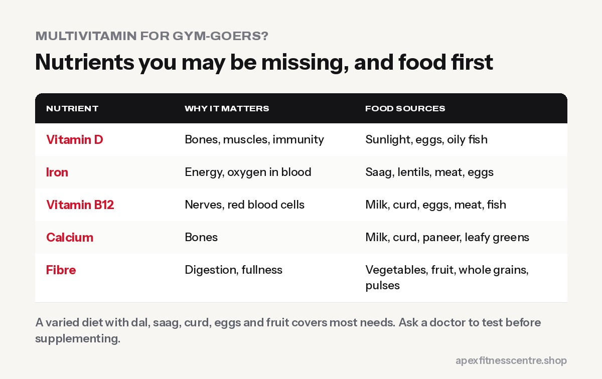

**If you eat a varied diet, most gym-goers don't need a multivitamin to build muscle or lose fat.** A multivitamin can act as a "safety net" if your diet is very limited, but it **does not boost strength, energy or muscle growth** in people who aren't deficient. If you suspect a specific deficiency (like vitamin D, iron or B12), a blood test and targeted advice from a doctor is better than guessing.

## When a multivitamin might help

- Your diet is **very limited** (few vegetables, fruits, dairy or protein foods)
- You're **eating very little** on a strict diet for a long time
- You're **vegetarian or vegan** and eat little dairy (B12 risk)
- Your doctor has advised it, for example in pregnancy (prenatal supplements)

## When it's probably a waste

- You eat dal, vegetables, fruit, dairy and some eggs, meat or fish regularly
- You hope it will give you **energy or muscle**. It won't if you're not deficient.

## Nutrients gym-goers in Nepal may miss

| Nutrient | Why it matters | Food sources |
|---|---|---|
| **Vitamin D** | Bones, muscles, immunity | Sunlight, eggs, oily fish |
| **Iron** | Energy, oxygen in blood | Saag, lentils, meat, eggs |
| **Vitamin B12** | Nerves, red blood cells | Milk, curd, eggs, meat, fish |
| **Calcium** | Bones | Milk, curd, paneer, leafy greens |
| **Fibre** | Digestion, fullness | Vegetables, fruit, whole grains, pulses |

Women with heavy periods, vegetarians and people who rarely go out in the sun should be especially aware of iron, B12 and vitamin D.

## Food first

A simple Nepali "multivitamin plate":

- **Saag or green vegetables** every day
- **Dal or other pulses** daily
- **Curd or milk** daily
- **Eggs, meat or fish** a few times a week (if you eat them)
- **Seasonal fruit** daily
- **Some sunlight** most days

## If you choose a multivitamin

- Pick a **standard daily multivitamin**, not "mega-dose" products.
- **Don't double up** with other supplements containing the same vitamins.
- **Check the label** for iron content if you're a man or postmenopausal woman; extra iron isn't always needed.
- Buy genuine products. See [how to spot fake supplements in Nepal](../fake-supplements-in-nepal-how-to-spot-them/).

## Better investments for gym results

1. Enough protein: [how much protein you need](../how-much-protein-do-you-need/)
2. Consistent training and progressive overload
3. Sleep
4. Creatine monohydrate, if you want a performance supplement

## Frequently asked questions

### Do multivitamins give you energy?

Only if you were deficient in something. Otherwise, they don't noticeably boost energy.

### Can I take a multivitamin with whey and creatine?

Yes, they don't interfere with each other.

### Are multivitamins safe?

Standard doses are generally safe for healthy adults. Mega-doses of some vitamins (like A and D) can be harmful.

### Should I get a blood test?

If you have symptoms like constant tiredness, hair loss or weakness, ask a doctor about blood tests rather than guessing with supplements.

*General information, not medical advice.*
