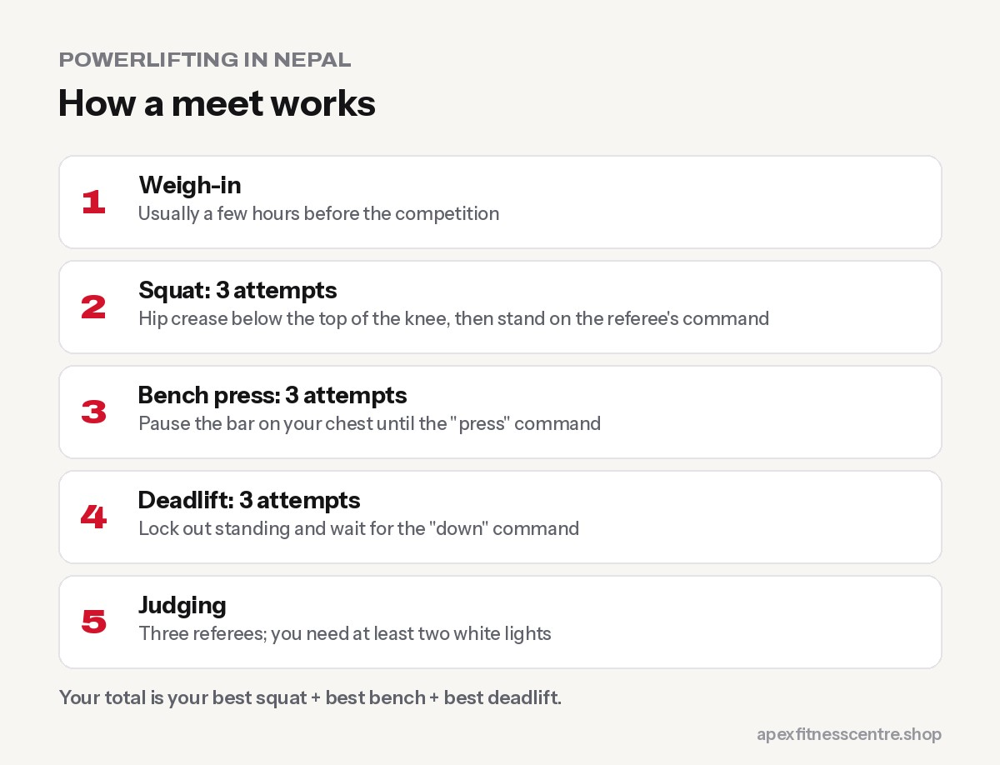

Powerlifting is a strength sport with just **three lifts: the squat, bench press and deadlift**. Each lifter gets **three attempts** at each lift, and the heaviest successful attempts are added together for your **total**. You compete against lifters in your **weight class** and age group.

It's one of the most beginner-friendly sports to compete in: if you already train these lifts in the gym, you're halfway there.

## Powerlifting in Nepal

Nepal has a small but growing powerlifting scene, with gyms and organisations holding open and national-level meets. For example, **Nepal Youth Fitness and Calisthenics (NYFC)** organised a **Nationwide Powerlifting Championship in 2023** at the National Sports Council's indoor hall in Kathmandu, with men's and women's open classes plus junior and masters categories ([The Kathmandu Post](https://kathmandupost.com/sports/2023/09/20/powerlifting-from-sept-25)).

Nepali lifters have also won medals abroad. At the World Power Lifting Championship held in India in December 2020, Nepal won **three golds and one silver** ([The Himalayan Times](https://thehimalayantimes.com/kathmandu/nepal-bags-three-gold-one-silver-in-world-power-lifting-championship/)).

Different organisations run events with slightly different rules, so always check the rulebook of the meet you enter.

## How a meet works

1. **Weigh-in** before the competition, usually a few hours before.
2. **Squat:** three attempts. You must squat until your hip crease is below the top of your knee, then stand up on the referee's commands.
3. **Bench press:** three attempts. Pause the bar on your chest until the "press" command.
4. **Deadlift:** three attempts. Lift the bar to a locked-out standing position and wait for the "down" command.
5. **Three referees** judge each lift; you need at least two white lights.
6. Your **best successful squat + bench + deadlift = total**.

## Weight classes and divisions

Meets group lifters by **body weight** and often by **age** (sub-junior, junior, open, masters). Some meets are **raw** (no supportive suits; belts, wrist wraps and knee sleeves usually allowed) and some include **equipped** divisions. Check the specific event's categories before you register.

## A beginner's path to your first meet

### Months 1–3: Learn the lifts

Follow a simple strength programme with squats, bench presses and deadlifts 2 to 3 times a week. See our guides on the [squat](../how-to-squat-properly/), [bench press](../how-to-bench-press-safely/) and [deadlift](../how-to-deadlift-for-beginners/).

### Months 4–6: Train like a powerlifter

- Practise **competition standards**: depth on squats, a pause on bench.
- Work in lower rep ranges (3 to 6) on main lifts.
- Use [progressive overload](../progressive-overload-explained/) and track every session.

### Meet preparation (last 6–8 weeks)

- Choose **opening attempts** you can lift even on a bad day (often around 90% of your best).
- Practise **commands** with a training partner.
- **Reduce training volume** in the final week so you're fresh.

## What you need on the day

- Lifting singlet or approved clothing (check rules)
- Flat shoes for squat and bench, flat or deadlift slippers for deadlift
- Belt, wrist wraps, knee sleeves (if allowed)
- Chalk, food, water and a calm friend to help with warm-ups

## A sample beginner powerlifting week

| Day | Main lift | Accessories |
|---|---|---|
| Sunday | Squat 4 × 5 | Romanian deadlift 3 × 8, plank 3 × 30 sec |
| Tuesday | Bench press 4 × 5 | Dumbbell row 3 × 10, overhead press 3 × 8 |
| Thursday | Deadlift 3 × 5 | Leg press 3 × 10, lat pulldown 3 × 10 |
| Friday (optional) | Bench press 3 × 8 (lighter) | Face pulls 3 × 15, triceps 3 × 12 |

Start with weights you can lift with good form and **add a small amount each week**. When progress stalls, a coach can help you move to a more advanced plan.

## Learn the competition rules early

Powerlifting meets have strict rules: squat depth (hip crease below the top of the knee), a pause on the chest in the bench press, and waiting for referee commands. Practise these rules in training so there are no surprises on the day.

## Frequently asked questions

### Do I need to be very strong to compete?

No. Many first-time lifters compete just to set a total and enjoy the experience. Everyone starts somewhere.

### Is powerlifting safe?

With good technique, sensible progression and proper warm-ups, powerlifting is generally safe. Most injuries come from poor form or rushing heavy weights.

### Can women compete in powerlifting?

Yes. Women compete in their own weight classes, and the sport is growing fast among women.

### How do I find powerlifting meets in Nepal?

Follow local gyms, strength coaches and organisations on social media, where meets are announced with registration details.

## Sources

- [ACSM position stand: progression models in resistance training for healthy adults](https://pubmed.ncbi.nlm.nih.gov/19204579/) (American College of Sports Medicine, 2009)

*Information checked on 23 October 2026 from the sources linked above.*
