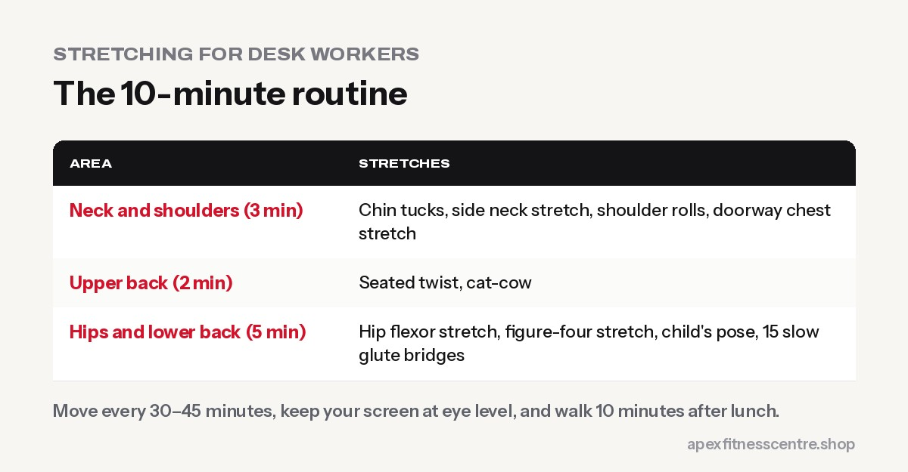

If you sit for most of the day, at a bank, office, shop counter or on a laptop at home, your **neck, upper back, hips and lower back** probably feel stiff. A **10-minute routine once or twice a day**, plus a few small habits, makes a big difference. Combine it with strength training and you'll feel better than stretching alone.

## The 10-minute routine

Hold each stretch for **20 to 30 seconds** and breathe slowly. Move gently; stretching should feel like tension, not pain.

### Neck and shoulders (3 minutes)

1. **Chin tucks:** sit tall, gently pull your chin straight back (double chin), hold 3 seconds, repeat 10 times.
2. **Side neck stretch:** ear towards shoulder, hand gently on head. Each side.
3. **Shoulder rolls:** 10 backwards, 10 forwards.
4. **Doorway chest stretch:** forearms on a doorframe, step forward gently.

### Upper back (2 minutes)

5. **Seated twist:** sit tall, turn your upper body to look behind you. Each side.
6. **Cat-cow:** on hands and knees, round and arch your back slowly, 10 times.

### Hips and lower back (5 minutes)

7. **Hip flexor stretch:** half-kneeling, push your hips gently forward. Each side.
8. **Figure-four stretch:** on your back or seated, ankle on opposite knee. Each side.
9. **Child's pose:** knees apart, sit back towards heels, arms forward.
10. **Glute bridges:** 15 slow reps to wake up hips that sit all day.

## Desk habits that help

- **Move every 30 to 45 minutes.** Stand, walk to fill your water bottle, take calls standing.
- **Screen at eye level.** Raise your laptop on books and use a separate keyboard if possible.
- **Feet flat, back supported.** A small cushion behind your lower back can help.
- **Walk after lunch** for 10 minutes.
- **Strength train 2 to 3 times a week.** Strong back and glutes support better posture. See our [beginner gym workout plan](../beginner-gym-workout-plan-first-3-months/).

## Exercises that undo sitting

| Exercise | Why |
|---|---|
| Rows and lat pulldowns | Strengthen the upper back |
| Glute bridges and hip thrusts | Wake up glutes |
| Romanian deadlifts | Strengthen the back of the body |
| Planks and dead bugs | Core support for the spine |
| Walking | Undoes a lot of sitting |

## When to see a doctor or physiotherapist

- Pain that **spreads down your arm or leg**, or comes with numbness or tingling
- Pain that is **getting worse** after 2 to 3 weeks
- Pain that **wakes you at night**
- Pain after a fall or injury

## A workday movement schedule

If you sit for 8 hours, break it up like this:

| Time | What to do |
|---|---|
| Every 30–45 minutes | Stand up, roll your shoulders, take a short walk to refill water |
| Mid-morning | Neck and shoulder stretches (3 minutes) |
| Lunch break | Walk for 10–15 minutes after eating |
| Mid-afternoon | Hip flexor stretch and upper-back opener (5 minutes) |
| After work | The full 10-minute routine, or a gym session |

Setting a phone reminder makes this much easier to stick to.

## Check your desk setup

- **Screen:** top of the screen at roughly eye level, about an arm's length away
- **Chair:** feet flat on the floor, knees about level with hips, lower back supported
- **Keyboard and mouse:** close enough that your elbows stay near your sides
- **Laptop users:** raise the laptop on a stand or books and use a separate keyboard

Small changes to your setup reduce the strain that stretching then has to undo.

## Frequently asked questions

### Is stretching enough to fix back pain from sitting?

Stretching helps stiffness, but strengthening exercises and moving more during the day usually help more.

### How often should desk workers stretch?

A short routine once or twice a day, plus standing and moving every 30 to 45 minutes.

### Should I stretch before or after the gym?

Dynamic movements before, longer static stretches after. See [the 10-minute warm-up before the gym](../warm-up-before-gym/).

### Is a standing desk better?

Alternating between sitting and standing is better than doing either all day.

## Sources

- [WHO fact sheet: physical activity](https://www.who.int/news-room/fact-sheets/detail/physical-activity) (World Health Organization)
- [Effects of warming-up on physical performance: a systematic review](https://pubmed.ncbi.nlm.nih.gov/19996770/) (Fradkin et al., 2010)

*General information, not medical advice.*
