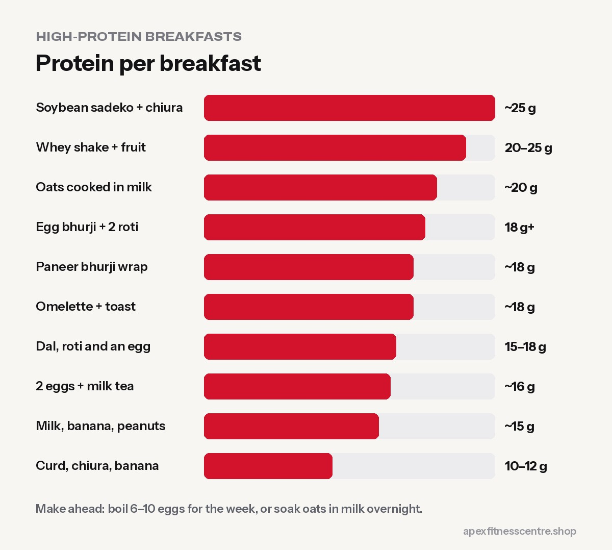

Many Nepali mornings start with **sweet milk tea and biscuits**, which is lots of sugar and almost no protein. Swapping that for a **high-protein breakfast** keeps you full longer, helps control cravings and supports muscle if you train. Aim for roughly **20 to 30 g of protein** at breakfast.

*Protein amounts are rough estimates and depend on portions.*

## Quick options (under 5 minutes)

1. **Boiled eggs + milk tea with less sugar:** 2 eggs ≈ 12 g, plus about 4 g from milk in tea.
2. **Curd with chiura and banana:** about 10 to 12 g. Add a handful of peanuts for more.
3. **Glass of milk + banana + handful of peanuts:** about 15 g.
4. **High-protein oats with milk:** about 20 g per bowl depending on brand and portion.
5. **Whey shake + fruit:** about 20 to 25 g per scoop.

## Cooked options (10–15 minutes)

6. **Egg bhurji with 2 roti:** 3 eggs ≈ 18 g, plus a few grams from roti.
7. **Masala omelette with toast:** 3 eggs ≈ 18 g.
8. **Paneer bhurji wrap:** 100 g paneer ≈ 18 g.
9. **Chana chatpate or chana curry with roti:** about 12 to 15 g per bowl.
10. **Leftover dal with roti and a boiled egg:** about 15 to 18 g.
11. **Soybean sadeko with chiura:** 50 g dry soy ≈ 25 g.
12. **Oats cooked in milk with peanut butter:** about 15 to 18 g.

## Breakfasts by goal

| Goal | Best picks |
|---|---|
| **Fat loss** | Eggs, egg whites, curd, paneer bhurji, soybean, vegetables |
| **Muscle gain** | Eggs + roti, oats in milk with peanut butter, milk shakes, paneer wraps |
| **Early-morning training** | Banana + milk before, eggs or a shake after |
| **Busy commuters** | Boiled eggs, curd cups, overnight oats in a jar |

## Make-ahead tips

- **Boil 6 to 10 eggs** at the start of the week and refrigerate.
- **Overnight oats:** mix oats, milk and curd in a jar at night; add fruit in the morning.
- **Soak and boil chana or soybean** for 2 to 3 days at a time.
- **Hang curd** overnight in a cloth for a thick, high-protein spread.

## What about the morning tea?

Keep your tea. Just **reduce the sugar** gradually: from 2 spoons to 1, then half. Your taste adapts within a couple of weeks.

## Frequently asked questions

### How much protein should breakfast have?

Around 20 to 30 g is a good target for most adults trying to build muscle or lose fat.

### Is it okay to skip breakfast?

Some people do well with a later first meal. If you skip breakfast and then overeat later, a protein breakfast usually helps.

### Are eggs every morning healthy?

For most healthy people, yes. See [how many eggs can you eat a day](../how-many-eggs-per-day/).

### What's a good vegetarian high-protein breakfast?

Paneer bhurji, curd with chiura and peanuts, soybean sadeko, or oats with milk. See [15 protein-rich vegetarian foods in Nepal](../protein-rich-vegetarian-foods-nepal/).

*General information, not medical advice.*
