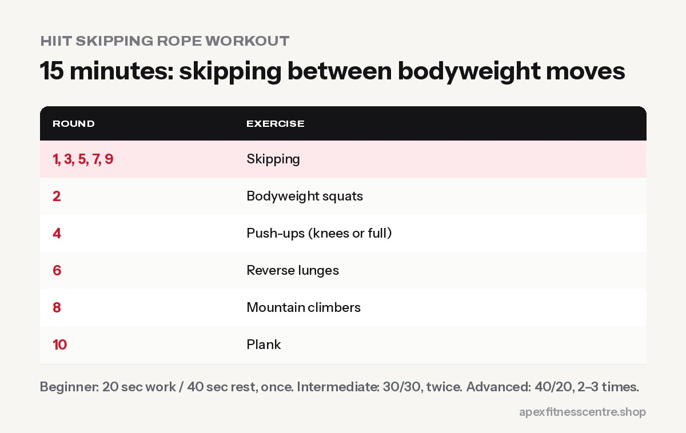

A skipping rope costs a few hundred rupees and gives you one of the most efficient cardio workouts available. Combined with simple bodyweight moves in a **HIIT format** (short hard efforts with rest), you can get a serious workout in **15 minutes** in a small room or on a rooftop.

HIIT is tiring, so **1 to 3 sessions a week** is plenty, alongside strength training and walking.

## Skipping technique basics

- **Rope length:** stand on the middle of the rope; the handles should reach your armpits.
- **Small jumps:** just 2 to 3 cm off the ground, landing softly on the balls of your feet.
- **Turn the rope with your wrists,** not your whole arms. Elbows close to your sides.
- **Look forward,** chest up.
- **Surface:** wooden floor, rubber mat or smooth concrete with good shoes. Avoid very hard tiles barefoot.

**Can't skip yet?** Practise the jumping rhythm without a rope, or turn the rope and step over it, until it clicks.

## The 15-minute workout

**Warm-up (3 minutes):** marching on the spot, arm circles, easy skipping or jumping jacks.

**Main workout (10 minutes):** 30 seconds work, 30 seconds rest. Repeat the circuit twice.

| Round | Exercise |
|---|---|
| 1 | Skipping |
| 2 | Bodyweight squats |
| 3 | Skipping |
| 4 | Push-ups (knees or full) |
| 5 | Skipping |
| 6 | Reverse lunges |
| 7 | Skipping |
| 8 | Mountain climbers |
| 9 | Skipping |
| 10 | Plank |

**Cool-down (2 minutes):** slow walking and gentle stretches.

## Beginner vs advanced

| Level | Work / rest | Rounds |
|---|---|---|
| Beginner | 20 sec / 40 sec | Circuit once |
| Intermediate | 30 sec / 30 sec | Circuit twice |
| Advanced | 40 sec / 20 sec | Circuit 2–3 times, add double-unders or high knees |

## How HIIT helps fat loss

HIIT burns a lot of energy in a short time and improves fitness quickly. But like all exercise, it supports fat loss best when combined with a **calorie deficit**. See [calorie deficit explained](../calorie-deficit-explained/) and [cardio vs weights for fat loss](../cardio-vs-weights-for-fat-loss/).

## Safety tips

- **Not for everyone:** if you have heart problems, high blood pressure, are very overweight, or have knee or ankle issues, start with walking and low-impact cardio and check with a doctor.
- **Good shoes** reduce stress on your shins and ankles.
- **Build up gradually.** Shin pain is a sign to cut back.
- **Don't do HIIT every day.** Recovery matters.

## A 4-week skipping progression

| Week | Work and rest | Rounds | Sessions a week |
|---|---|---|---|
| 1 | 20 sec skipping, 40 sec rest | 8 | 2 |
| 2 | 30 sec skipping, 30 sec rest | 8 | 2 |
| 3 | 30 sec skipping, 30 sec rest | 10–12 | 2–3 |
| 4 | 40 sec skipping, 20 sec rest | 10 | 2–3 |

If you trip often, that's normal at first. Keep going and count total skips rather than perfect rounds.

## Choosing a skipping rope

- **Length:** stand on the middle of the rope; the handles should reach roughly your armpits.
- **Type:** a simple PVC or beaded rope is best for beginners; very thin speed ropes are harder to time.
- **Surface:** wooden floors, rubber gym floors or flat ground. Avoid rough concrete for long sessions.
- **Shoes:** cushioned trainers, not slippers or bare feet.

## Combining skipping with strength

Skipping works well as a 10-minute finisher after weight training, or on its own on cardio days. Keep at least 2 strength sessions a week for muscle and bone health.

## Frequently asked questions

### Is skipping good for weight loss?

Yes, as part of a plan with a calorie deficit. It's an efficient cardio exercise you can do anywhere.

### How long should I skip rope per day?

Beginners can start with 5 to 10 minutes of intervals. Build up gradually.

### Does skipping make your calves bigger?

It strengthens your calves. Big size changes depend on genetics and other training.

### Can I do this workout every day?

Do HIIT 1 to 3 times a week. On other days, walk or do strength training.

## Sources

- [WHO fact sheet: physical activity](https://www.who.int/news-room/fact-sheets/detail/physical-activity) (World Health Organization)
- [Effects of warming-up on physical performance: a systematic review](https://pubmed.ncbi.nlm.nih.gov/19996770/) (Fradkin et al., 2010)

*Want a full no-equipment routine? Try our [home workout without equipment](../home-workout-without-equipment/).*
