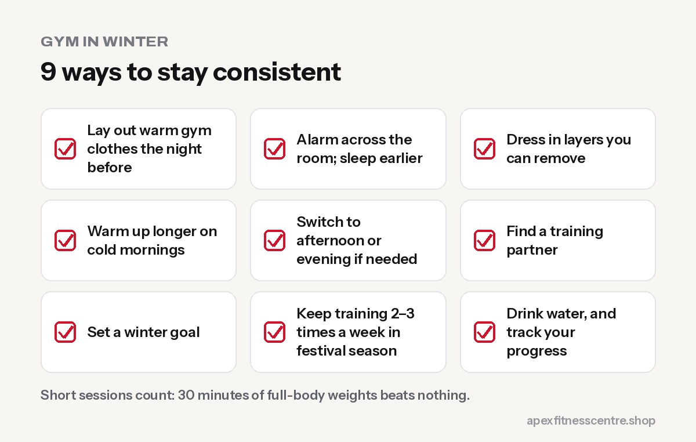

Winter is when gym attendance drops. Mornings are cold, the warm blanket wins, days are short, and the festival season (Dashain, Tihar, then weddings and picnics) brings plenty of heavy food. The people who **keep training through winter** usually start the new year noticeably ahead. Here's how to be one of them.

## 1. Lower the barrier to getting out of bed

- **Lay out gym clothes the night before**, ideally warm layers.
- **Put your alarm across the room.**
- **Sleep earlier.** Waking at 5 AM is much easier after 7 to 8 hours of sleep.
- **Make a deal with yourself:** just go and do the warm-up. Most days you'll stay.

## 2. Dress in layers

Arrive in a **jacket, track pants and a cap**, and take layers off as you warm up. Keep a dry T-shirt to change into after training so you don't catch a chill on the way home.

## 3. Warm up longer

Cold muscles and joints need more time. Spend **7 to 10 minutes** on light cardio and mobility before lifting. See [the 10-minute warm-up before the gym](../warm-up-before-gym/).

## 4. Consider switching to afternoon or evening

If early mornings are impossible in winter, train **later in the day** for a few months. The best time to train is the time you'll actually show up. See [best time to go to the gym](../best-time-to-go-to-the-gym/).

## 5. Find a training partner

Agreeing to meet a friend at 6 AM makes skipping much harder. A partner also makes winter sessions more fun.

## 6. Set a winter goal

Pick something concrete for the next 8 to 12 weeks: add 10 kg to your squat, do your [first pull-up](../pull-ups-for-beginners/), or lose 3 cm off your waist. A goal gives each session a purpose.

## 7. Plan for the festival season

- **Don't aim for perfection.** Enjoy the feasts, but keep training 2 to 3 times a week.
- **Short sessions count.** 30 minutes of full-body weights beats nothing.
- **Walk after big meals.**
- **Keep protein high** on non-feast days.

## 8. Drink water even when it's cold

You feel less thirsty in winter but still lose water through breathing and sweating. Warm water or herbal tea counts. See [how much water you should drink](../how-much-water-should-you-drink/).

## 9. Track your progress

Seeing numbers improve in your notebook or app is powerful motivation on dark mornings. Read [progressive overload explained](../progressive-overload-explained/).

## Winter benefits you might not expect

- **Gyms are often quieter** at certain hours.
- **Training builds warmth** and energy for the rest of the day.
- **Strength gains** made in winter carry into spring and summer.
- **Less sweaty sessions** mean many people can train a little harder.

## A sample winter week

| Day | Session |
|---|---|
| Sunday | Full-body strength (45–60 min) |
| Monday | 20–30 min brisk walk at lunchtime, in the sun |
| Tuesday | Full-body strength |
| Wednesday | Rest or light mobility at home |
| Thursday | Full-body strength |
| Friday | Skipping or cardio intervals (15–20 min) |
| Saturday | Rest |

Three strength sessions are enough to keep progressing through winter. On very cold or busy weeks, two is far better than none.

## Winter food that supports training

- **Warm, high-protein meals:** dal, eggs, chicken or soybean curry, gundruk soup with soybeans
- **Seasonal vegetables:** cauliflower, cabbage, radish, peas, saag
- **Hot drinks:** ginger or lemon tea, with less sugar
- **Watch the festival snacks:** sel roti and sweets are fine in moderation, but they add up quickly

## Frequently asked questions

### Is it harder to build muscle in winter?

No. Muscle growth depends on training, protein and recovery, not the season.

### Should I eat more in winter?

Many people do because of festivals and cold weather. Keep portions sensible and protein high.

### Is it bad to exercise in the cold?

For healthy people, no, as long as you warm up properly and dress in layers. People with heart or breathing conditions should follow their doctor's advice.

### What if I miss a week during the festivals?

Just come back. A week off won't undo months of progress.

## Sources

- [WHO fact sheet: physical activity](https://www.who.int/news-room/fact-sheets/detail/physical-activity) (World Health Organization)
- [Effects of warming-up on physical performance: a systematic review](https://pubmed.ncbi.nlm.nih.gov/19996770/) (Fradkin et al., 2010)
- [Vitamin D fact sheet for consumers](https://ods.od.nih.gov/factsheets/vitamind-consumer/) (NIH Office of Dietary Supplements)

*Photo: a member at Apex Fitness Centre, Urlabari. We're open from 4:30 AM, so early risers can train before work.*
