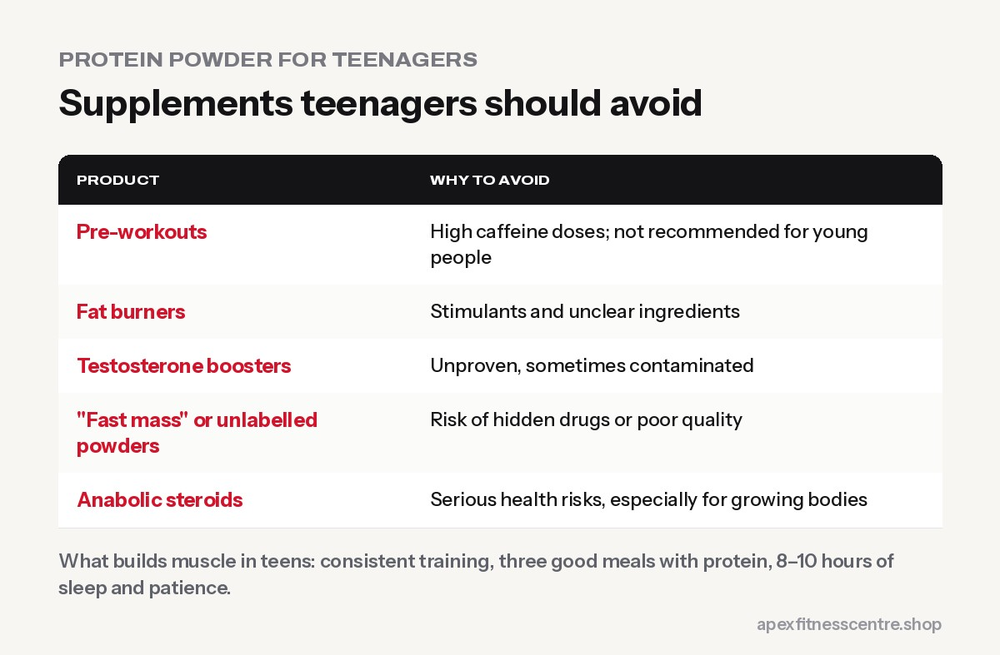

**Supervised strength training is generally considered safe and beneficial for teenagers.** Most teens, however, **can get all the protein they need from food**, so protein powder is usually unnecessary. Pre-workouts, fat burners, testosterone boosters and anything promising fast muscle are **not suitable for teenagers**.

This guide is for parents and teens trying to make sensible choices.

## Can teenagers lift weights?

Yes. Many health and sports organisations support **properly supervised strength training** for young people, with good technique and sensible progression. Benefits include:

- Stronger muscles and bones
- Better sports performance
- Lower injury risk in sports
- Confidence and healthy habits

**Key safety rules:**

- **Learn technique first** with light weights, ideally with a qualified trainer.
- **No maximal lifting** until technique and experience are solid.
- **Warm up properly.**
- **Avoid training through pain.**

The old myth that weight training stunts growth is not supported by evidence when training is supervised and sensible.

## Do teenagers need protein powder?

Usually **no**. Growing teens do need enough protein, but most can get it from:

- Eggs, milk, curd, paneer
- Dal, chana, rajma, soybean
- Chicken, fish, meat

A teen who eats **three meals with a protein food each, plus milk or curd**, is usually covered. See [how much protein you need](../how-much-protein-do-you-need/) and [15 protein-rich vegetarian foods in Nepal](../protein-rich-vegetarian-foods-nepal/).

Whey protein is essentially a milk protein, so it's **not dangerous** for most healthy teens in normal amounts. But it costs money that's better spent on good food, and it can replace real meals. If a teen genuinely struggles to eat enough, speak to a doctor or dietitian first.

## Supplements teenagers should avoid

| Product | Why to avoid |
|---|---|
| **Pre-workouts** | High caffeine doses; not recommended for young people. See [is pre-workout safe?](../is-pre-workout-safe/) |
| **Fat burners** | Stimulants and unclear ingredients |
| **Testosterone boosters** | Unproven, sometimes contaminated |
| **"Fast mass" or unlabelled powders** | Risk of hidden drugs or poor quality |
| **Anabolic steroids** | Serious health risks, especially for growing bodies |

Creatine is sometimes used by older teen athletes under guidance, but the decision should involve a doctor, and food, sleep and training come first.

## What actually builds muscle in teens

1. **Consistent training** 2 to 4 times a week
2. **Three good meals a day** with protein, plus healthy snacks
3. **8 to 10 hours of sleep**, which teens need more than adults
4. **Patience:** natural growth and hormones do a lot of the work

## Advice for parents

- **Talk openly** about body image. Social media can make teens feel pressure to look a certain way.
- **Watch for warning signs:** extreme dieting, obsessive training, secret supplement use, or sudden big changes in body shape.
- **Choose a gym with trainers** who work with young people responsibly.

## Frequently asked questions

### At what age can you start going to the gym?

Many gyms accept teens from around 14 to 16, often with parental consent. Supervised training with good technique matters more than the exact age.

### Is whey protein safe for a 16-year-old?

In normal food-like amounts, whey is generally not harmful for healthy teens, but it's usually unnecessary if they eat enough protein from food. Ask a doctor if unsure.

### Will lifting weights stop my child's growth?

No. That's a myth. Supervised, sensible strength training does not stunt growth.

### Can teens take creatine?

Discuss it with a doctor first. Food, sleep and training should come first.

*General information, not medical advice. Parents should consult a doctor about their child's nutrition and supplements.*
