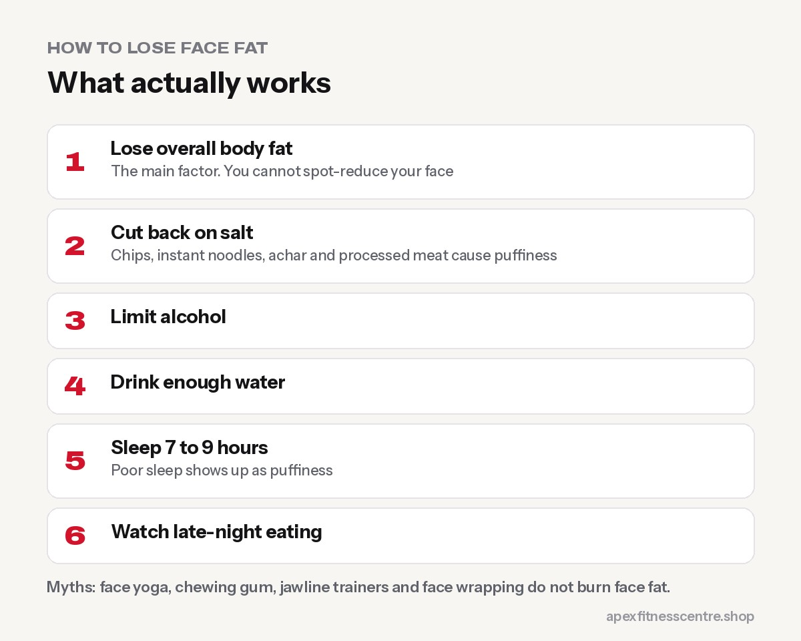

You can't target fat loss to your face. **Face fat goes down when your overall body fat goes down**, and puffiness often improves when you cut back on **salt, alcohol and late-night eating** and sleep better. Face yoga, chewing gum and jawline gadgets don't burn face fat.

## Why your face looks fuller

- **Overall body fat:** the main factor.
- **Water retention:** salty food (chips, instant noodles, achar, processed meat), alcohol, and hormonal changes can make your face puffy, especially in the morning.
- **Poor sleep:** often shows up as puffiness and dark circles.
- **Genetics and age:** some people naturally store more fat in the face; others lose facial fullness with age.

## What actually works

### 1. Lose overall body fat

A steady calorie deficit, enough protein, strength training and daily walking. Your face will follow your body. See [calorie deficit explained](../calorie-deficit-explained/).

### 2. Cut back on salt

Reduce packaged snacks, instant noodles and very salty achar. Cook with a little less salt. Puffiness can drop within days.

### 3. Limit alcohol

Alcohol adds calories and causes water retention and puffiness.

### 4. Drink enough water

Being well hydrated helps your body manage fluid balance. See [how much water you should drink](../how-much-water-should-you-drink/).

### 5. Sleep 7 to 9 hours

Poor sleep often shows on your face first, and it increases hunger.

### 6. Watch late-night eating

Large, salty meals late at night often mean a puffier face in the morning.

## Myths

| Myth | Truth |
|---|---|
| Face yoga burns face fat | It may tone muscles slightly but doesn't burn fat |
| Chewing gum slims your jaw | No evidence it reduces fat |
| Jawline trainers and gadgets | Not for fat loss; may strain your jaw |
| Wrapping your face | Temporary water shift at best |

## How long does it take?

It depends on how much body fat you have to lose. Many people notice their face looking slimmer after **losing a few kilos**. Water-related puffiness can improve within **days** of cutting salt and alcohol.

## Take photos

Take a front photo in the same light once a month. Faces change slowly, so photos show progress you won't notice in the mirror day to day.

## When to see a doctor

If facial swelling appears suddenly, is on one side only, or comes with other symptoms like swelling in your legs, breathlessness or weight gain without explanation, see a doctor. Some medical conditions and medicines cause facial puffiness.

## Frequently asked questions

### Can you lose face fat in a week?

You can reduce puffiness in a week by cutting salt and alcohol and sleeping better. Actual fat loss takes longer.

### Does losing weight make your face look older?

Losing a lot of weight quickly can make the face look thinner. Slow, steady fat loss with good nutrition usually looks healthier.

### Do facial exercises work?

They may strengthen facial muscles, but they don't target fat.

### What foods cause a puffy face?

Very salty foods, alcohol and lots of refined, processed food are common culprits.

*Read also: [how to lose belly fat](../how-to-lose-belly-fat/). General information, not medical advice.*
