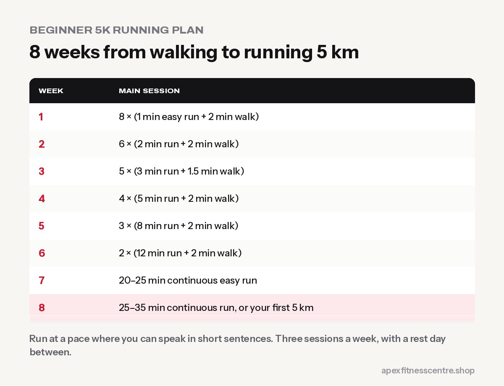

If you can walk briskly for 30 minutes, you can learn to run **5 km in about 8 weeks**. The trick is to start with **walk-run intervals** and build up slowly, so your heart, lungs, muscles and joints all adapt together.

## Before you start

- **Shoes:** comfortable running shoes that fit well. You don't need the most expensive pair.
- **Route:** a flat road, park, school ground or track. Early mornings are cooler and quieter.
- **Pace:** you should be able to speak in short sentences. If you can't, slow down.
- **Health check:** if you have heart problems, high blood pressure or are very overweight, check with a doctor first.

## The 8-week walk-run plan

Run **3 times a week**, with a rest or walking day in between. Every session starts with a **5-minute brisk walk** warm-up and ends with a **5-minute walk** cool-down.

| Week | Main session |
|---|---|
| 1 | 8 x (1 min easy run + 2 min walk) |
| 2 | 6 x (2 min run + 2 min walk) |
| 3 | 5 x (3 min run + 1.5 min walk) |
| 4 | 4 x (5 min run + 2 min walk) |
| 5 | 3 x (8 min run + 2 min walk) |
| 6 | 2 x (12 min run + 2 min walk) |
| 7 | 20–25 min continuous easy run |
| 8 | 25–35 min continuous run, or your first 5 km |

**Repeat a week** if it felt too hard. There's no rush.

## Running technique tips

- **Short, quick steps** rather than long strides.
- **Land softly** with your foot under your body.
- **Relax your shoulders** and hands.
- **Breathe** in a steady rhythm through your nose and mouth.
- **Look ahead,** not at your feet.

## Avoiding shin pain and injuries

- **Don't increase too fast.** Most running injuries come from doing too much too soon.
- **Run on softer surfaces** when you can: track, grass or dirt paths.
- **Strength train twice a week:** squats, lunges, calf raises and glute bridges make your legs more resilient. See [leg day for beginners](../leg-day-for-beginners/).
- **Rest** if pain is sharp or getting worse.

## Running in Nepal

- **Kathmandu valley:** early mornings before traffic and dust; consider a mask on dusty days.
- **Terai summer:** run very early or late; carry water.
- **Hills:** great for fitness, but start on flatter routes until your legs are used to running.
- **Monsoon:** watch for slippery roads; a treadmill is a safe backup.

## Running and weight loss

Running burns a lot of energy, but it also makes many people hungrier. Combine it with a sensible diet for fat loss. See [walking for weight loss](../walking-for-weight-loss-steps/) and [cardio vs weights for fat loss](../cardio-vs-weights-for-fat-loss/).

## Frequently asked questions

### How long does it take to run 5 km as a beginner?

Many beginners complete their first 5 km in roughly 30 to 45 minutes. Finishing is the goal; speed comes later.

### Should I run every day?

Not as a beginner. Three runs a week with rest days in between is safer and still very effective.

### Is running bad for your knees?

For most healthy people, sensible running with gradual progression is not harmful to the knees. Strength training helps protect them.

### Can I use a treadmill for this plan?

Yes. Set a slight incline of about 1% to feel more like outdoor running.

*Running and trekking go well together. See our [Everest Base Camp training plan](../everest-base-camp-trek-training-plan/).*
