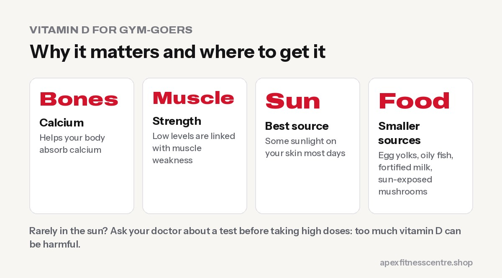

You might think low vitamin D is rare in a sunny country like Nepal, but deficiency is **common across South Asia**, and it has been studied in Nepal too, for example in [this study from Lalitpur](https://www.nepjol.info/index.php/jgpemn/article/view/89717). Indoor jobs, covered clothing, darker skin, air pollution and winter months all reduce how much vitamin D your skin makes. Vitamin D matters for **bones, muscles and immunity**, so it's worth paying attention to, but **test before you supplement heavily**.

## Why vitamin D matters

- **Bones:** helps your body absorb calcium.
- **Muscles:** low levels are linked with muscle weakness.
- **Immunity:** plays a role in immune function.

For gym-goers, being deficient can make you feel weaker and more tired. Correcting a deficiency can help; taking extra when your levels are already normal usually doesn't boost performance.

## Possible signs of low vitamin D

- Tiredness
- Muscle weakness or aches
- Bone or back pain
- Frequent infections

These signs are common to many conditions, so a **blood test** is the only way to know.

## How to get vitamin D in Nepal

### Sunlight

Your skin makes vitamin D from sunlight. Short periods of sun on arms and face, a few times a week, help many people. The amount needed varies with skin colour, season, time of day and altitude. **Avoid sunburn**, and protect your skin during long exposure.

### Food

Few foods are rich in vitamin D:

- **Oily fish** (where available)
- **Egg yolks**
- **Fortified foods** (some milk and cereals; check the label)
- **Mushrooms exposed to sunlight** contain some

Food alone often isn't enough, which is why sun and, when needed, supplements matter.

## Should you take a vitamin D supplement?

- **If a blood test shows you're low,** your doctor will advise the dose and duration.
- **If you rarely get sun** (indoor work, covered clothing, long winters), ask your doctor whether a low daily dose is suitable.
- **Avoid very high doses without testing.** Too much vitamin D can cause harmful calcium build-up.

## Who is at higher risk

- People who work indoors all day
- Those who cover most of their skin outdoors
- Older adults
- People with darker skin
- People with obesity
- Pregnant and breastfeeding women
- People with certain digestive or kidney conditions

## Morning gym-goers and vitamin D

If you train early, work indoors and go home after dark, you may get very little sunlight, especially in winter. A few simple habits help:

- **Take a short walk outdoors** around midday a few days a week
- **Sitting by a window doesn't count:** glass blocks most of the UVB light your skin needs to make vitamin D
- **Eat vitamin D foods** such as eggs (the yolk), oily fish and fortified milk
- **Ask your doctor** about testing if you often feel tired, have bone pain or spend little time outdoors

## Don't overdo supplements

More isn't better. Very high doses of vitamin D taken for long periods can raise calcium levels in the blood and cause harm. Follow your doctor's advice on the dose, especially if a test shows you're low, and check other supplements you take (such as multivitamins) so you don't double up.

## Frequently asked questions

### Does vitamin D help build muscle?

If you're deficient, correcting it can support muscle function. If your levels are normal, extra vitamin D isn't shown to build more muscle.

### How long should I stay in the sun for vitamin D?

It depends on skin type, season, time of day and location. Short, regular exposure without burning is the general idea; ask a doctor for personal advice.

### Can I take vitamin D with other supplements?

Usually yes, but check the total vitamin D across all your products, including multivitamins.

### Should I get my vitamin D tested?

If you have symptoms or risk factors, a test is a sensible first step. Ask your doctor.

## Sources

- [Vitamin D study from Lalitpur](https://www.nepjol.info/index.php/jgpemn/article/view/89717) (NepJOL)
- [Vitamin D fact sheet for consumers](https://ods.od.nih.gov/factsheets/vitamind-consumer/) (NIH Office of Dietary Supplements)

*Related: [do gym-goers need a multivitamin?](../multivitamin-for-gym/). General information, not medical advice.*
