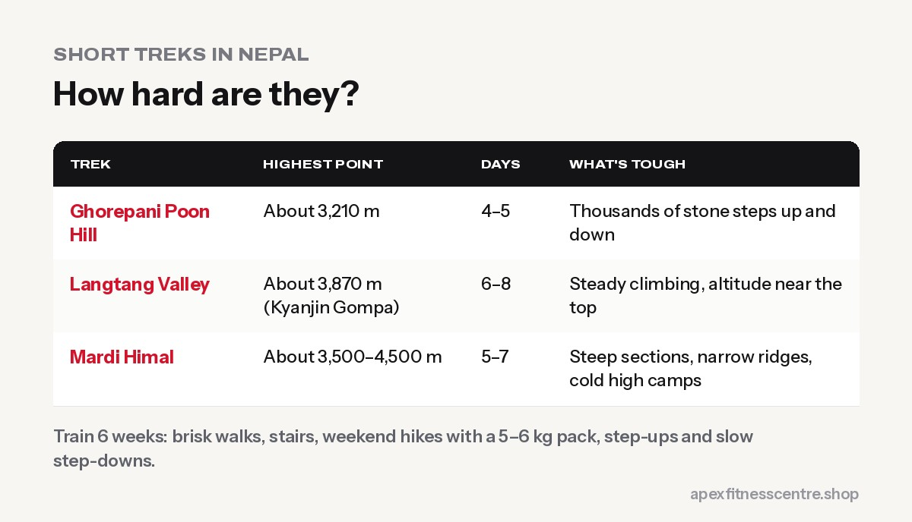

Not every trek in Nepal needs months of preparation. Popular shorter treks like **Ghorepani Poon Hill**, **Langtang Valley** and **Mardi Himal** are achievable for most healthy people with **about 6 weeks of training**. You'll still face long days of up-and-down walking, so arriving fit makes them far more enjoyable.

## How hard are these treks?

| Trek | Highest point (approx.) | Typical length | What's tough |
|---|---|---|---|
| **Ghorepani Poon Hill** | Poon Hill viewpoint, about 3,210 m | 4–5 days | Thousands of stone steps up and down |
| **Langtang Valley** | Kyanjin Gompa about 3,870 m; optional viewpoints higher | 6–8 days | Steady climbing, altitude near the top |
| **Mardi Himal** | High Camp and viewpoints, around 3,500–4,500 m | 5–7 days | Steep sections, narrow ridges, colder high camps |

Exact heights, routes and durations vary with the itinerary you choose.

## A 6-week training plan

| Weeks | Plan |
|---|---|
| 1–2 | 3 brisk walks of 45 minutes; 1 hilly walk of 2 hours; strength 2x a week |
| 3–4 | Stairs or incline treadmill 2x a week (30 min); weekend hike of 3–4 hours with a 5–6 kg pack |
| 5 | Back-to-back weekend hikes (Sat and Sun), lots of stairs and downhill |
| 6 | Easy week: short walks and stretching before you go |

## Key exercises

Twice a week, 3 sets of 10 to 15:

- **Step-ups** with a backpack (the Poon Hill steps will thank you)
- **Lunges**
- **Squats:** see [how to squat properly](../how-to-squat-properly/)
- **Slow step-downs** for downhill strength
- **Calf raises**
- **Planks**

## Altitude basics

Langtang and Mardi Himal go above 3,500 m, where some people feel the altitude.

- **Don't rush;** follow an itinerary with sensible daily height gains.
- **Drink water and avoid alcohol.**
- **Watch for symptoms:** headache, nausea, dizziness, unusual tiredness.
- **Descend** if symptoms get worse, and seek help for severe symptoms.

For bigger treks, see our [Everest Base Camp training plan](../everest-base-camp-trek-training-plan/) and [Annapurna Circuit fitness guide](../annapurna-circuit-trek-fitness/).

## Packing tips for short treks

- **Broken-in boots** or trail shoes
- **Layers:** mornings and evenings get cold, even after a warm day
- **Rain jacket,** especially in shoulder seasons
- **Trekking poles** for the steps and descents
- **Water bottle and purification**
- **Snacks:** nuts, chocolate, dried fruit, chana

## Check before you go

Check the current **permit requirements**, trail conditions and whether a licensed guide is required for your route and season. Rules have changed in recent years, so confirm with official sources or a registered trekking agency.

## Frequently asked questions

### Is Poon Hill trek easy?

It's one of the easier treks, but the many stone steps make it tiring. With some stair training, most healthy people manage it well.

### Which short trek is best for beginners?

Poon Hill is often recommended for first-timers because of its lower altitude and good facilities. Langtang Valley is also popular.

### Do I need to go to the gym before a trek?

It helps, especially leg strength and stair work, but real hikes with a backpack are the most important training.

### Can I get altitude sickness on short treks?

It's possible above about 2,500 to 3,000 m. Going slowly and staying hydrated helps; descend if symptoms worsen.

*General information, not medical advice. Check with a doctor before trekking at altitude if you have health conditions.*
