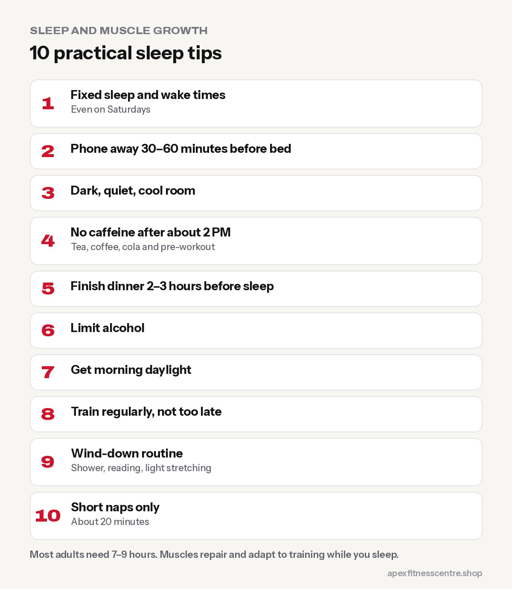

If you train hard but sleep 5 hours a night, you're leaving results on the table. Adults are generally advised to get **at least 7 hours of sleep a night**, and many active people feel best with **7 to 9 hours**. Sleep is when your body recovers, repairs muscle and resets hunger hormones, and **no supplement can replace it**.

## What sleep does for gym results

- **Recovery:** muscles repair and adapt to training, much of it during sleep.
- **Strength and performance:** poor sleep is linked with lower motivation, worse coordination and weaker workouts.
- **Hormones:** sleep affects hormones involved in recovery, hunger and stress.
- **Fat loss:** short sleep increases hunger and cravings, especially for sugary and fatty food, making a calorie deficit harder.
- **Injury risk:** tiredness reduces focus and technique.

## Signs you're not sleeping enough

- You need an alarm and feel groggy every morning
- Constant afternoon tiredness
- Strong cravings, especially in the evening
- Workouts feel harder than usual
- Irritability or low mood

## 10 practical sleep tips

1. **Fixed sleep and wake times,** even on Saturdays.
2. **Phone away** 30 to 60 minutes before bed. Bright screens and scrolling keep your brain alert.
3. **Dark, quiet, cool room.** Curtains, an eye mask or earplugs help in busy areas.
4. **No caffeine after about 2 PM**, including tea, coffee, cola and pre-workout. See [is pre-workout safe?](../is-pre-workout-safe/).
5. **Don't eat a huge meal right before bed.** Finish dinner 2 to 3 hours before sleep where possible.
6. **Limit alcohol.** It may make you sleepy but reduces sleep quality.
7. **Get morning daylight,** a short walk outside helps set your body clock.
8. **Train regularly,** but finish very intense sessions a few hours before bed if they keep you awake.
9. **Wind-down routine:** shower, reading, light stretching.
10. **Short naps** (20 minutes) can help, but long late naps can disrupt night sleep.

## Early-morning trainers: plan backwards

If you train at **5 AM**, you need to be asleep by around **9:30 to 10 PM** to get 7 hours. Gyms like Apex open at 4:30 AM for early risers, but the habit only works if bedtime moves earlier too. See [best time to go to the gym](../best-time-to-go-to-the-gym/).

## Rest days and sleep together

Rest days and good sleep are a team. Read [rest days: how many do you need?](../rest-days-how-many-per-week/).

## When to see a doctor

- **Loud snoring** with pauses in breathing or gasping (possible sleep apnoea)
- **Long-term insomnia** despite good habits
- **Extreme daytime sleepiness**

## A sleep plan for the 4:30 AM trainer

If you train at Apex as soon as we open at 4:30 AM, work backwards to protect your sleep:

| Time | What to do |
|---|---|
| 8:00 PM | Finish dinner |
| 8:30 PM | Lay out gym clothes, fill water bottle |
| 9:00 PM | Phone away, lights dim |
| 9:15 PM | Lights out |
| 4:00 AM | Wake up, light snack if you need one |
| 4:30 AM | Training |

That gives roughly 7 hours. If that's not realistic for you, an evening session (4:30 to 8:30 PM) might suit you better.

## Naps

A short nap of 20–30 minutes in the early afternoon can help if you slept badly. Avoid long naps late in the day, which can make it harder to sleep at night.

## Frequently asked questions

### How much sleep do you need to build muscle?

Most adults should aim for at least 7 hours, and many active people do best with 7 to 9.

### Can I build muscle with 5 to 6 hours of sleep?

You can still make some progress, but recovery and results are usually better with more sleep.

### Is it bad to work out when sleep-deprived?

Light training is fine. Very heavy lifting when exhausted increases injury risk. Adjust intensity.

### Do sleep supplements help?

Some people use them, but fixing sleep habits usually helps more. Ask a doctor before using sleep aids regularly.

## Sources

- [How many hours of sleep are enough?](https://www.mayoclinic.org/healthy-lifestyle/adult-health/expert-answers/sleep/faq-20057898) (Mayo Clinic)
- [Protein supplementation and resistance training: systematic review and meta-analysis](https://bjsm.bmj.com/content/52/6/376) (Morton et al., British Journal of Sports Medicine, 2018)

*General information, not medical advice.*
