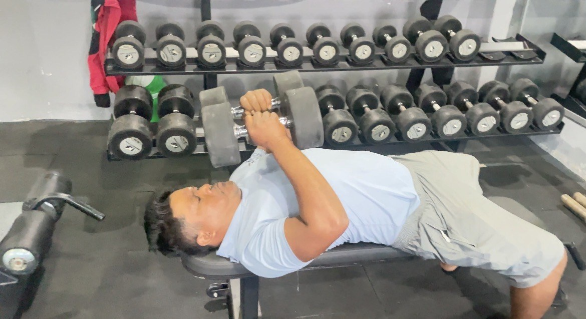
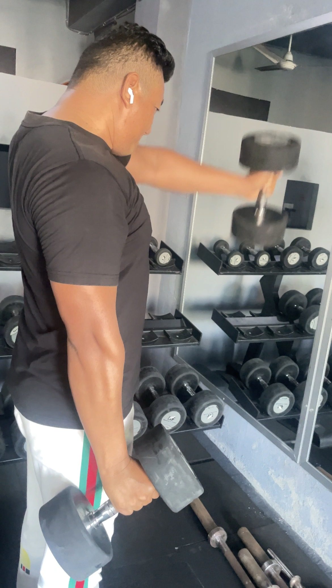

You can build real strength at home with a pair of dumbbells. **Do one full-body workout three times a week, with six basic exercises, and add a little weight or a few reps every week.** That is enough to get stronger, build some muscle and meet the World Health Organization's advice to do muscle-strengthening activity on at least two days a week ([WHO](https://www.who.int/news-room/fact-sheets/detail/physical-activity)).

*A member at Apex Fitness Centre doing a dumbbell press. At home, the floor press works the same muscles without a bench.*

## What you need

- **A pair of dumbbells.** Adjustable dumbbells are best because you can add weight as you get stronger. If you buy fixed ones, start with a light pair and a heavier pair.
- A sturdy chair or bench for step-ups and rows.
- A mat or a carpet for floor exercises.

Not sure what to buy first? See [how to build a home gym on a budget](../home-gym-on-a-budget/).

## How heavy should your dumbbells be?

Pick a weight you can lift for the target reps with good form, finishing each set feeling that you could do 2 or 3 more. If you can do 5 or more extra reps, it is too light. If your form breaks down before the last rep, it is too heavy.

Most beginners need a lighter weight for shoulder and arm exercises and a heavier one for squats and rows.

## The workout

Do it three times a week with a rest day in between, for example Sunday, Tuesday and Thursday. Rest about 60 to 90 seconds between sets.

| # | Exercise | Sets x reps | What it trains |
|---|---|---|---|
| 1 | Goblet squat | 3 x 10 to 12 | Legs and glutes |
| 2 | One-arm dumbbell row (hand on a chair) | 3 x 10 each side | Back and biceps |
| 3 | Floor press | 3 x 10 to 12 | Chest, shoulders, triceps |
| 4 | Romanian deadlift | 3 x 10 | Hamstrings, glutes, lower back |
| 5 | Step-up onto a chair | 2 x 8 each leg | Legs and balance |
| 6 | Shoulder press (seated) | 2 x 10 | Shoulders and triceps |

Finish with a 30 to 45 second plank, twice.

## How to do each exercise

**Goblet squat.** Hold one dumbbell upright against your chest. Feet shoulder-width apart, sit back and down until your thighs are about parallel to the floor, then stand up. Keep your chest up and heels on the floor. More tips: [how to squat properly](../how-to-squat-properly/).

One-arm row. Put one hand and knee on a chair, back flat. Pull the dumbbell up towards your hip, then lower it slowly.

Floor press. Lie on your back with knees bent, a dumbbell in each hand. Press the weights up over your chest, then lower until your upper arms touch the floor.

Romanian deadlift. Stand tall with the dumbbells in front of your thighs. Push your hips back and slide the weights down your legs, keeping your back flat, until you feel a stretch in the back of your thighs. Stand up by pushing your hips forward. Our [deadlift guide](../how-to-deadlift-for-beginners/) explains the hip hinge in detail.

Step-up. Hold the dumbbells at your sides and step onto a sturdy chair, then step down slowly.

Shoulder press. Sit tall with the dumbbells at shoulder height and press them overhead without arching your lower back.

*A member doing lateral raises, a good shoulder exercise to add once the basics feel easy.*

## How to progress over 8 weeks

Progress is what turns a workout into results. Use this simple rule, called double progression:

1. Start each exercise at the bottom of the rep range, for example 10.
2. Each week, try to add one rep per set.
3. When you can do the top of the range (12) for all sets with good form, use a slightly heavier weight and drop back to 10.

Write your weights and reps down. Read more in [progressive overload explained](../progressive-overload-explained/).

## Warm up first

Spend 5 minutes before you start: march on the spot, arm circles, 10 bodyweight squats, and one light set of the first exercise. Our [warm-up guide](../warm-up-before-gym/) has a full routine.

## When you are ready for more

After 8 to 12 weeks, many people move to a gym for heavier weights and more equipment. Our [beginner gym workout plan](../beginner-gym-workout-plan-first-3-months/) picks up where this one ends. No dumbbells at all? Start with a [home workout without equipment](../home-workout-without-equipment/).

## A sample week

| Day | What to do |
|---|---|
| Sunday | Dumbbell workout |
| Monday | Rest or a 30-minute walk |
| Tuesday | Dumbbell workout |
| Wednesday | Rest or a walk |
| Thursday | Dumbbell workout |
| Friday and Saturday | Walk, play a sport or rest |

## Frequently asked questions

### Can I build muscle with only dumbbells at home?
Yes, especially as a beginner. As long as you keep adding reps or weight over time and eat enough protein, you can build muscle with dumbbells.

### How many days a week should a beginner use dumbbells?
Three full-body sessions a week, with a rest day between them, is a good start. Two sessions also work if that is all you have time for.

### What weight dumbbells should a beginner buy?
Adjustable dumbbells are the most useful. If you buy fixed pairs, get one light pair for shoulders and arms and one heavier pair for squats and rows.

### How long until I see results?
Most people feel stronger within a few weeks. Visible changes usually take a few months of steady training and good eating.

### Should I train if I am sore?
Mild soreness is normal. Train if you can move normally; rest or do an easy walk if it is very sore. See [muscle soreness after the gym](../muscle-soreness-after-gym/).

## Sources

- [WHO fact sheet: physical activity](https://www.who.int/news-room/fact-sheets/detail/physical-activity) (World Health Organization)
- [Strength exercises](https://www.nhs.uk/live-well/exercise/strength-exercises/) (NHS)

*General information, not medical advice. If you have a heart condition, high blood pressure or an injury, ask your doctor before starting strength training.*
