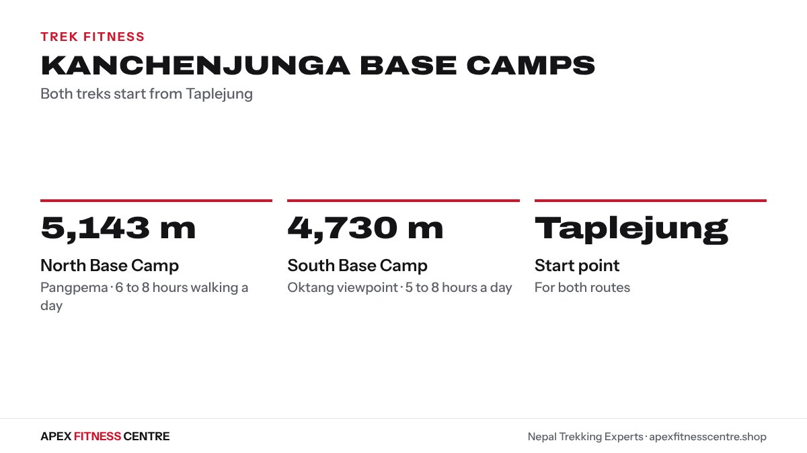

Kanchenjunga Base Camp is one of the longest and most remote treks in Nepal. **To enjoy it, you need to walk 6 to 8 hours a day for many days in a row, on rough trails, with simple food and few ways out.** A 12-week plan of long walks, stair or hill climbs and leg strength is the best way to get ready.

We are based in Morang, in eastern Nepal, and the trek starts in Taplejung district, the same district as the walk to Pathibhara temple. Here is how to prepare.

## The two base camps

Figures from the comparison by [Nepal Trekking Experts](https://nepaltrekkingexperts.com/blog/kanchenjunga-north-vs-south-base-camp-trek):

| | North Base Camp | South Base Camp |
|---|---|---|
| Name | Pangpema | Oktang viewpoint |
| Height | About 5,143 m | About 4,730 m |
| Daily walking | 6 to 8 hours | 5 to 8 hours |
| Start | Taplejung | Taplejung |

*Kanchenjunga base camps. Source: Nepal Trekking Experts.*

Many trekkers combine the two, crossing high passes such as Selele La and Sinion La between them. Kanchenjunga is a restricted area, so trekking is arranged through a registered agency with a licensed guide; check the current rules and permits with your agency before you book.

## Why Kanchenjunga is hard

- **Length.** It is a long trek, and the combined north and south route is longer still.
- Remoteness. Villages and teahouses are small and far apart, and there are few roads.
- Big ups and downs. The trail climbs and drops through deep valleys before reaching high ground, so your legs work hard both ways.
- Altitude. The north base camp is above 5,000 m, high enough for altitude sickness.

## Self-test: are you ready?

| Test | Ready if you can... |
|---|---|
| Long walk | Walk 6 hours with breaks, then 4 hours the next day |
| Stairs | Walk up and down 25 floors at a steady pace |
| Strength | 20 step-ups on each leg onto a knee-height step |
| Pack walk | Walk 2 hours with the pack you will carry |
| Descent | Walk down 15 floors without knee pain |

## The 12-week plan

Train 5 days a week: 2 climb sessions, 2 strength sessions and 1 long walk (plus a shorter walk the next day from week 5).

| Weeks | Climb sessions | Long walk | Pack |
|---|---|---|---|
| 1 to 3 | 30 to 45 min stairs, hills or incline treadmill | 2 to 3 hours | None to 4 kg |
| 4 | Easier week | 2 hours | 4 kg |
| 5 to 7 | 45 to 60 min | 4 to 5 hours, plus 2 hours next day | 5 to 6 kg |
| 8 | Easier week | 3 hours | 6 kg |
| 9 to 11 | 60 min, some faster climbs | 6 hours, plus 3 to 4 hours next day | Trek pack |
| 12 | Easy, short sessions | 2 hours | Trek pack |

**Strength, twice a week:** step-ups with a slow step down, goblet squats, reverse lunges, Romanian deadlifts, calf raises and a plank, 3 sets of 8 to 12.

Easier weeks (4, 8 and 12) are planned on purpose. Your body gets fitter during rest, not only during hard sessions.

No hills near you? Use our [8-week plan for flat countries](../train-for-nepal-trek-without-hills/) for ideas on stairs and incline training, and the [stair climbing workout](../stair-climbing-workout/) for sessions.

## Protect your knees on the descents

The deep valleys mean long, steep descents. Train for them:

- Step down slowly in every step-up set.
- Walk down stairs in training, not only up.
- Use two trekking poles. A 1999 study in the Journal of Sports Sciences found poles reduced a key knee force by up to about 20% when walking downhill ([NY-NJ Trail Conference summary](https://www.nynjtc.org/node/3489)).

## Altitude

Fitness does not protect you from altitude sickness; a slow ascent does ([TravelHealthPro](https://travelhealthpro.org.uk/factsheets/altitude-illness)). Above 3,000 m, sleep no more than about 500 m higher each night and take a rest day every three or four days. Read [altitude sickness on Nepal treks](../altitude-sickness-nepal-trek/) before you go.

## Food and energy

On long remote treks, food choices are simple, and appetite often falls higher up. Eat at every meal, carry quick-energy snacks, and drink regularly. See [what to eat on a Nepal trek](../what-to-eat-on-nepal-trek/). Walking with family? Our [Pathibhara trek with family](../pathibhara-trek-with-family/) guide covers pacing for children and older parents in the same district.

## What to pack for training days

Train with the same things you will carry on the trek, so nothing is new in the mountains:

- The boots you will wear, worn in for at least 30 to 40 hours of walking
- Your trek backpack, with the hip belt adjusted so the weight sits on your hips
- The socks you will bring
- Your trekking poles, so you learn to use them on stairs and hills
- The water bottle or bladder you will drink from

## Frequently asked questions

### How difficult is the Kanchenjunga Base Camp trek?
It is a strenuous trek: long, remote and high, with big climbs and descents. It suits people who have trekked before or who train well for it.

### How high is Kanchenjunga Base Camp?
The north base camp (Pangpema) is about 5,143 m and the south base camp (Oktang) is about 4,730 m.

### Where does the Kanchenjunga trek start?
In Taplejung district in eastern Nepal.

### Do I need a guide for Kanchenjunga?
It is a restricted area, so treks are arranged through a registered agency with a licensed guide. Check the current rules before you book.

### How long should I train?
About 12 weeks if you are already active; longer if you are starting from little exercise.

## Sources

- [Kanchenjunga north vs south base camp trek](https://nepaltrekkingexperts.com/blog/kanchenjunga-north-vs-south-base-camp-trek) (Nepal Trekking Experts)
- [Trekking poles and your knees](https://www.nynjtc.org/node/3489) (New York-New Jersey Trail Conference)
- [Altitude illness factsheet](https://travelhealthpro.org.uk/factsheets/altitude-illness) (TravelHealthPro)

*General information, not medical advice. See a doctor before a high-altitude trek if you have a heart, lung, blood pressure or joint condition.*
