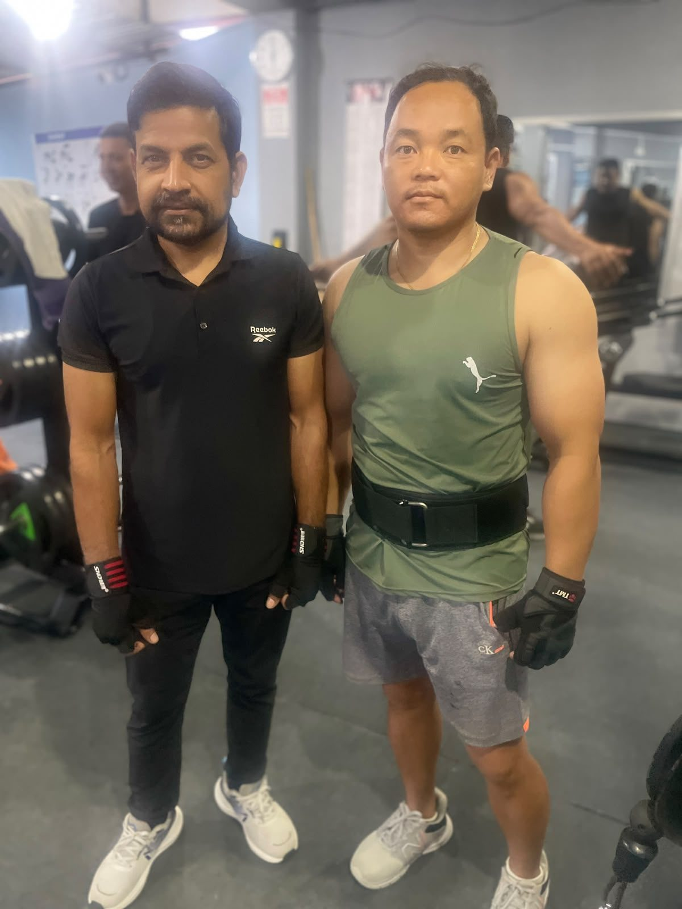

Most beginners do not need a lifting belt. **A belt is a tool for heavy sets of squats, deadlifts and presses. It helps you brace your core harder, which can help you lift a bit more, but it does not prevent back injuries on its own.** Learn to brace without a belt first, then add one for your heaviest sets once your lifts get serious.

*Members at Apex Fitness Centre in Urlabari. Belts are for the heavy sets, not every exercise.*

## What a lifting belt actually does

When you take a big breath and tighten your stomach before a heavy lift, the pressure inside your abdomen rises. This "bracing" makes your trunk stiff, so force moves from your legs to the bar more efficiently.

A belt gives your core something to push against, so the pressure can rise higher. A review of the research by Barbell Medicine reports that in one deadlift study (Harman and colleagues, 1989), pressure inside the abdomen averaged 156 mmHg without a belt and 175 mmHg with one, at 90% of a lifter's maximum ([Barbell Medicine](https://www.barbellmedicine.com/blog/the-science-of-weight-lifting-belts/)).

## Does a belt help you lift more?

Probably a little. The same review describes studies where lifters moved heavy squats faster with a belt, and one where a heavy deadlift felt about two points easier on a 10-point effort scale. It also notes that no study has directly measured whether people lift more weight with a belt, so the evidence is promising but not complete.

## Does a belt prevent back injuries?

Not on its own. According to the same review, studies of belts in workplaces did not show they reliably reduce low back injuries, and the authors conclude that lifting belts "do not significantly decrease or increase the risk of injury." Good technique, sensible weights and steady progress protect your back far more than any belt.

## Does a belt make your core weak?

This is a common worry. The review reports that trunk muscles still work hard with a belt on, and one study found trunk strength and endurance improved in workers who used belts regularly. You can also keep doing plenty of lifts without a belt, so your core still trains on its own.

## Who should use a belt?

| You are... | Belt? |
|---|---|
| New to lifting (first 6 to 12 months) | Not needed. Learn to brace first. |
| Lifting heavy squats and deadlifts regularly | Useful for your heaviest sets |
| Training for powerlifting | Yes, for competition lifts |
| Doing machines, curls, light sets or cardio | No |
| Using one because your back already hurts | See a doctor or physiotherapist first |

## How to brace (with or without a belt)

1. Stand ready for the lift.
2. Breathe in deeply through your nose, filling your stomach, not your chest.
3. Tighten your stomach as if someone is about to poke you.
4. Hold that breath and tension while you lift, then breathe out at the top.

Practise this on every heavy set from day one. A belt only makes good bracing better; it does not replace it.

## How to wear a belt

- **Position:** around your waist, over your stomach and lower back, usually just above the hip bones.
- **Tightness:** snug enough that you can push your stomach out against it, but loose enough to take a deep breath.
- **When:** put it on for your last warm-up set and your heaviest working sets, then loosen it between sets.

Squats and deadlifts need different setups; see [how to squat properly](../how-to-squat-properly/) and [how to deadlift for beginners](../how-to-deadlift-for-beginners/).

## Choosing a belt

For general gym use, a simple nylon or leather belt with a buckle or Velcro is fine. Nylon belts like the [Valeo weightlifting belt](../../products/valeo-weightlifting-belt/) are comfortable and easy to adjust; thick leather belts are popular with powerlifters. Pick the size by measuring your waist where you will wear it.

## Build the strength that matters most

A belt helps on heavy sets, but steady progress is what makes you strong. Read [progressive overload explained](../progressive-overload-explained/) and [powerlifting in Nepal: getting started](../powerlifting-in-nepal-getting-started/) if you want to lift heavier over time.

## Frequently asked questions

### Do beginners need a weightlifting belt?
No. Spend your first months learning technique and how to brace. Add a belt later for your heaviest squats and deadlifts.

### Does a lifting belt prevent back injury?
Research does not show that belts reliably prevent back injuries. Good technique and sensible progress matter more.

### When should I wear a lifting belt?
For heavy sets of squats, deadlifts and overhead presses, usually from your last warm-up set onwards. Take it off for lighter exercises.

### How tight should a lifting belt be?
Tight enough to push your stomach against it, loose enough to take a deep breath.

### Will a belt make my core weaker?
Research suggests trunk muscles still work hard with a belt on, and you will train your core on all the lifts you do without one.

## Sources

- [The science of weight lifting belts](https://www.barbellmedicine.com/blog/the-science-of-weight-lifting-belts/) (Barbell Medicine, reviewing Harman et al. 1989, Zink et al. 2001, Fong et al. 2022 and others)
- [Strength exercises](https://www.nhs.uk/live-well/exercise/strength-exercises/) (NHS)

*General information, not medical advice. If you have back pain, a hernia or high blood pressure, ask a doctor before heavy lifting or using a belt.*
