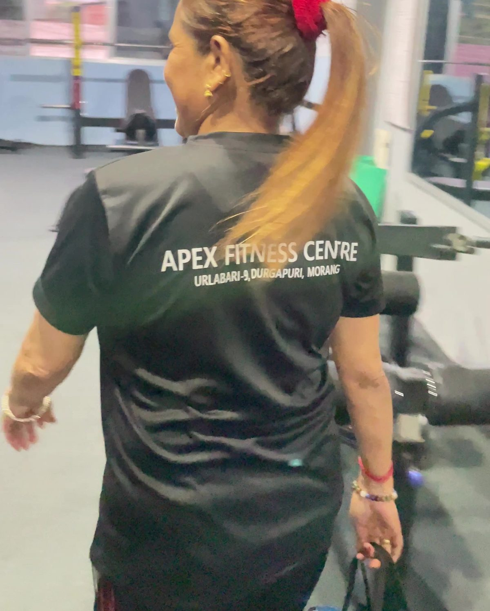
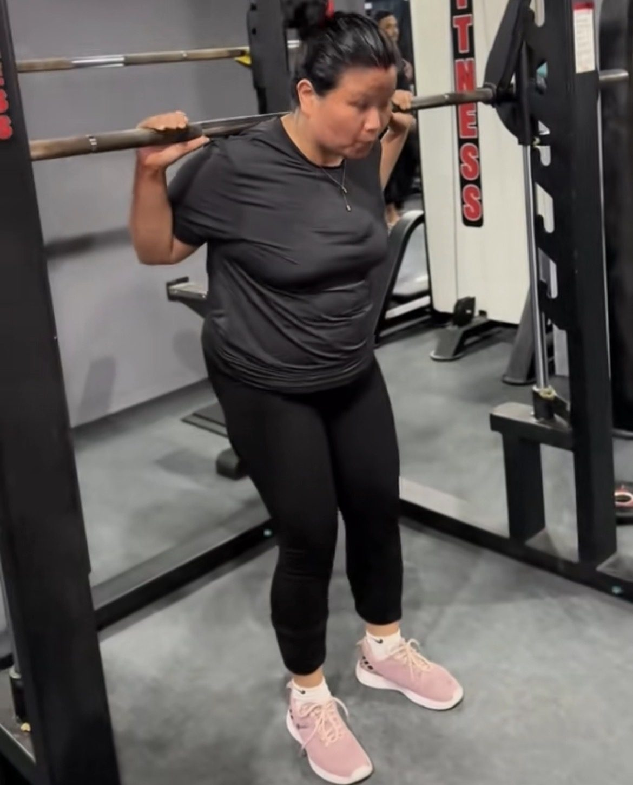

Stronger glutes come from a few exercises done well and made harder over time. **Train your glutes two or three times a week with hip thrusts, squats, Romanian deadlifts and lunges, and add a little weight or a few reps every week.** That is more effective than doing hundreds of bodyweight kickbacks.

Strong glutes are not only about looks. They help you climb stairs, carry shopping, stand tall and protect your knees and back.

*Walking in for her session at Apex Fitness Centre, Urlabari. Strength training is for every age.*

## Your glutes in one minute

Your glutes are three muscles: the large gluteus maximus that shapes your bottom and drives you up from a squat, and two smaller muscles on the side of the hip that keep your pelvis level when you walk. A good glute workout trains both: hip extension (driving the hips forward) and hip abduction (moving the leg out to the side).

## The 6 exercises

| Exercise | Sets x reps | Where |
|---|---|---|
| Hip thrust | 3 x 10 to 12 | Gym (barbell) or home (bodyweight or dumbbell) |
| Goblet squat | 3 x 10 | Gym or home |
| Romanian deadlift | 3 x 10 | Gym or home with dumbbells |
| Reverse lunge | 3 x 8 each leg | Gym or home |
| Step-up | 2 x 10 each leg | Bench or sturdy chair |
| Banded side walk or side-lying leg raise | 2 x 15 each side | Anywhere |

Rest 60 to 90 seconds between sets.

### Hip thrust
Sit on the floor with your upper back against a bench, a weight over your hips (a barbell with a pad, or a dumbbell). Feet flat, about hip-width apart. Push through your heels and lift your hips until your body is straight from shoulders to knees. Squeeze, then lower slowly.

### Goblet squat
Hold a dumbbell at your chest and sit back and down between your heels, chest up. Go as deep as you can with a flat back. See [how to squat properly](../how-to-squat-properly/).

*A member squatting in the Smith machine at Apex Fitness Centre. Once goblet squats feel easy, a barbell squat is the next step.*

### Romanian deadlift
Hold dumbbells or a bar in front of your thighs, push your hips back with a flat back until you feel a stretch in your hamstrings, then drive your hips forward to stand. More detail in [how to deadlift for beginners](../how-to-deadlift-for-beginners/).

### Reverse lunge
Step one leg back and lower until both knees are bent, then push through the front heel to stand. Leaning your body slightly forward works the glutes more.

### Step-up
Step onto a bench or chair, pushing through the heel of the top leg. Lower slowly.

### Side walks or side-lying leg raises
For the side of the hip. With a small band around your thighs, take side steps keeping tension; or lie on your side and lift the top leg slowly.

## How often and how hard

- **Two or three sessions a week,** with at least one day between them.
- Close to effort: finish each set feeling you could do only 2 or 3 more reps.
- Progress every week: one more rep or a little more weight. Write it down. See [progressive overload explained](../progressive-overload-explained/).

You can do this as a separate workout or add three of the exercises to a full-body plan like our [beginner gym workout plan](../beginner-gym-workout-plan-first-3-months/).

## Will I get bulky?

No. Building a lot of muscle takes years of hard training and plenty of food. Most women who lift get stronger and more toned, not bulky. Our post on [strength training myths for women](../strength-training-for-women-myths/) explains why.

## Food for glute growth

Muscle needs protein. Most people who exercise do well on about 1.4 to 2.0 g of protein per kg of body weight a day ([ISSN](https://pubmed.ncbi.nlm.nih.gov/28642676/)). Use the [protein calculator](../../calculators/protein-calculator/) and get most of it from food: dal, eggs, curd, paneer, chicken, fish and soybean.

## How long until you see results?

Most women feel stronger within a few weeks. Visible change usually takes two to three months of steady training and good eating. Take a photo and measure your hips once a month, rather than checking the mirror every day.

## New to the gym?

If you have never trained before, start with [our gym guide for women](../gym-guide-for-women-first-visit/). Training through your cycle? Read [exercise during periods](../exercise-during-periods/).

## Frequently asked questions

### What is the best exercise for glutes?
Hip thrusts, squats and Romanian deadlifts are among the most effective. A mix of them, done with progressive weight, works best.

### How many times a week should I train glutes?
Two or three times a week, with a rest day between sessions.

### Can I grow my glutes at home?
Yes. Bodyweight and dumbbell hip thrusts, squats, lunges and step-ups work well. Add weight or reps over time.

### Do squats alone build glutes?
Squats help, but adding hip thrusts and Romanian deadlifts trains the glutes more completely.

### Will glute training make my legs bigger?
Your legs will get stronger and more shapely. Big size gains take a long time and lots of food, so most women simply look more toned.

## Sources

- [Strength exercises](https://www.nhs.uk/live-well/exercise/strength-exercises/) (NHS)
- [ISSN position stand: protein and exercise](https://pubmed.ncbi.nlm.nih.gov/28642676/) (Jäger et al., 2017)

*General information, not medical advice. If you are pregnant, have recently given birth or have a hip, knee or back problem, ask a doctor or physiotherapist which exercises suit you.*
