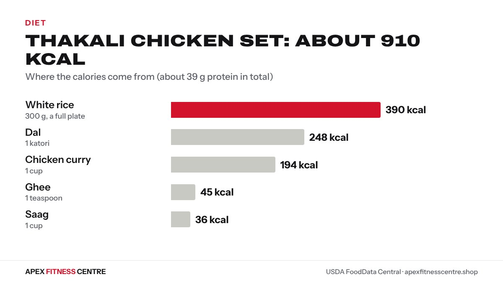

A Thakali set is a big, balanced meal, and also a big one for calories. **A typical chicken Thakali set with one serving of each item is roughly 900 calories and about 45 g of protein; a veg set is roughly 700 calories.** Refills, extra ghee and a second helping of rice can push it well over 1,200.

There is no official nutrition label for a Thakali set, so these are estimates, built from the USDA values for each part of the plate on our [food calorie chart](../../food/).

## What is in a Thakali set?

The Thakali kitchen comes from the Thak Khola area of Mustang, and the set is now served all over Nepal. Restaurants vary, but most sets include:

- Rice (bhat)
- Black lentil dal, often thin and well seasoned
- A meat curry (chicken or mutton) or a vegetable curry
- Saag (greens)
- Gundruk or a vegetable side
- Achar (pickles)
- A spoon of ghee on the rice
- Papad in some restaurants

Many Thakali restaurants offer refills of rice, dal and vegetables.

## Estimated calories, part by part

| Part of the plate | Portion | Calories (approx.) | Protein (approx.) |
|---|---|---|---|
| [White rice](../../food/rice-white-calories/) | 300 g (a full plate) | 390 kcal | 8.1 g |
| [Dal](../../food/dal-calories/) | 1 katori (150 g) | 248 kcal | 12.6 g |
| [Chicken curry](../../food/chicken-curry-calories/) | 1 cup (236 g) | 194 kcal | 14.9 g |
| [Saag](../../food/saag-calories/) | 1 cup (140 g) | 36 kcal | 3.6 g |
| [Ghee](../../food/ghee-calories/) | 1 teaspoon (5 g) | 45 kcal | 0 g |
| Achar and gundruk | Small servings | small | small |
| **Total, chicken set** | | about 910 kcal | about 39 g |

*Thakali chicken set: about 910 kcal. Source: USDA FoodData Central.*

Mutton set: swap the chicken curry for [mutton curry](../../food/mutton-curry-calories/) (about 222 kcal per cup), for about 940 kcal.

Veg set: without meat, with a vegetable curry instead, the plate is closer to 700 to 750 kcal and about 25 g of protein.

Each refill of rice adds about 130 kcal per 100 g, and each extra katori of dal about 248 kcal.

## Is a Thakali set healthy?

Yes, as meals go, it is one of the better restaurant choices in Nepal:

- **Freshly cooked** dal, vegetables and meat
- Protein from dal and meat
- Vegetables and fibre from saag, gundruk and dal
- Less deep-fried food than many restaurant meals

The catch is portion size. The rice and refills, plus ghee, add up fast.

## Eating a Thakali set while losing weight

You do not need to avoid it. Try this:

1. **Ask for half rice,** or leave a third of the plate.
2. Take refills of dal and vegetables, not rice.
3. Skip the extra ghee, or have just one spoon.
4. Choose the chicken set if you want more protein for the calories.
5. Eat slowly, finishing the vegetables and protein first.

Our [Nepali diet plan for weight loss](../weight-loss-diet-plan-nepali-food/) uses the same plate method, and [is dal bhat healthy?](../is-dal-bhat-healthy/) explains how to balance it.

## For gym-goers and trekkers

If you are building muscle or trekking, a full Thakali set is excellent fuel: plenty of carbs, protein and vegetables. Thakali food is common along the Annapurna trails; see [what to eat on a Nepal trek](../what-to-eat-on-nepal-trek/).

## How a Thakali set compares

| Meal | Calories (approx.) |
|---|---|
| Thakali chicken set (one serving of each item) | about 910 kcal |
| Typical dal bhat plate (rice, dal, saag) | about 794 kcal |
| Plate of 10 steamed momo | about 394 kcal |
| Chicken biryani, 350 g plate | about 361 kcal |

The Thakali set is the biggest of these, but it also has the most protein and vegetables. Numbers for the other dishes come from our [dal bhat](../../food/dal-bhat-calories/), [momo](../../food/momo-calories/) and [chicken biryani](../../food/chicken-biryani-calories/) pages.

## Frequently asked questions

### How many calories are in a Thakali set?
Roughly 900 calories for a chicken set and 700 to 750 for a veg set, with one serving of each item. Refills and extra ghee add more. These are estimates built from USDA values for each part.

### How much protein is in a Thakali set?
About 39 g in a chicken set and about 25 g in a veg set, mostly from the dal and meat.

### Is a Thakali set good for weight loss?
It can be, with half the rice and refills of dal and vegetables instead of rice.

### Is Thakali dal different from normal dal?
Many Thakali kitchens use black lentils and a thinner, well-seasoned dal. Our numbers use a standard lentil dal made with oil, so treat them as estimates.

### Which Thakali set has the most protein?
The chicken or mutton set, because the meat curry adds about 11 to 15 g of protein.

## Sources

- Food values from [USDA FoodData Central](https://fdc.nal.usda.gov/), as shown on our [food calorie chart](../../food/)
- [WHO fact sheet: healthy diet](https://www.who.int/news-room/fact-sheets/detail/healthy-diet) (World Health Organization)

*General information, not medical advice. Restaurant portions vary; treat these numbers as estimates.*
