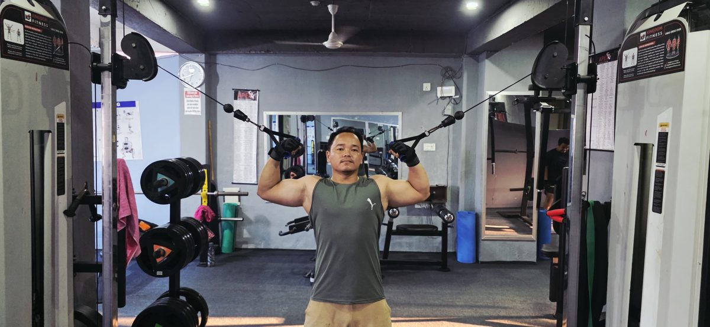

The cable machine looks complicated, but it is one of the most beginner-friendly tools in the gym. **The pulley keeps tension on your muscles through the whole movement, the weight changes with one pin, and the handle follows a smooth path.** Learn the eight exercises below and you can train your whole body on one station.

*A member on the cable crossover at Apex Fitness Centre, Urlabari.*

## How the cable machine works

- **Weight stack:** move the pin to choose the weight. Start light.
- **Pulley height:** slide it up or down. High for pushdowns and face pulls, middle for rows and chest flies, low for curls and pull-throughs.
- **Attachments:** single handle, straight bar, rope. Clip them on with the carabiner.
- **Single or double:** one stack for one-arm work, both sides (a crossover) for chest flies.

## The 8 exercises

| # | Exercise | Pulley | Attachment | Sets x reps |
|---|---|---|---|---|
| 1 | Seated cable row | Low, seated station | V-handle or bar | 3 x 10 to 12 |
| 2 | Lat pulldown | High, seated station | Wide bar | 3 x 10 to 12 |
| 3 | Cable chest fly | Middle, both sides | Single handles | 3 x 12 |
| 4 | Face pull | High | Rope | 3 x 12 to 15 |
| 5 | Triceps pushdown | High | Rope or bar | 3 x 12 |
| 6 | Cable biceps curl | Low | Bar or rope | 3 x 12 |
| 7 | Cable pull-through | Low | Rope | 3 x 12 |
| 8 | Pallof press | Middle | Single handle | 3 x 10 each side |

### 1. Seated cable row
Sit tall, chest up, and pull the handle to your stomach, squeezing your shoulder blades together. Return slowly.

### 2. Lat pulldown
Hold the bar wider than your shoulders and pull it to your upper chest, leading with your elbows. Do not swing.

### 3. Cable chest fly
Stand in the middle of the crossover with a handle in each hand, one foot forward. With a slight bend in your elbows, bring your hands together in front of your chest, then open slowly.

### 4. Face pull
With the rope at head height, pull the ends towards your face, elbows high and out. Great for shoulder health.

### 5. Triceps pushdown
Elbows tucked at your sides, push the rope or bar down until your arms are straight. Keep your upper arms still.

### 6. Cable biceps curl
Stand facing a low pulley, curl the bar or rope up without moving your elbows forward.

### 7. Cable pull-through
Face away from a low pulley with the rope between your legs. Push your hips back, then drive them forward to stand tall. Trains glutes and hamstrings.

### 8. Pallof press
Stand side-on to a pulley at chest height, hold the handle at your chest, and press it straight out. Do not let the cable twist you. A simple, safe core exercise.

## A simple cable workout

Do exercises 1, 3, 5, 6 and 8 on one day, and 2, 4, 7 and 8 on another, alongside your normal leg training. Or add two or three cable moves to the end of our [beginner gym workout plan](../beginner-gym-workout-plan-first-3-months/).

## Tips for beginners

1. **Start light** and add one plate when you can do all reps with good form. See [progressive overload explained](../progressive-overload-explained/).
2. **Control the return.** Let the weight come back slowly; do not let the stack slam.
3. **Stand stable,** with a split stance or feet shoulder-width apart.
4. **Ask a trainer** to show you the pulley and pin settings on your first day. If the gym makes you nervous, read [gym anxiety: how to feel confident](../gym-anxiety/).

## Cables vs free weights

Both work. Free weights like dumbbells and barbells train balance and are great for big strength lifts. Cables keep tension on the muscle through the whole movement and make it easy to change the weight. Most good programmes use both.

## Frequently asked questions

### Are cable machines good for beginners?
Yes. They are easy to set up, the weight is easy to change, and the path of the movement is smooth and controlled.

### Can you build muscle with only cables?
Yes, as long as you add weight or reps over time and eat enough protein. Most people combine cables with free weights.

### What is the cable crossover machine used for?
Chest flies, face pulls, curls, pushdowns, rows and core exercises. It has two adjustable pulleys, so you can train one or both arms.

### How much weight should I use on the cable machine?
Start with a weight you can lift for the target reps with good form and 2 or 3 reps to spare, then add a plate when it gets easy.

### Are cable exercises safe for the lower back?
Most are, because you can choose a stable stance and light weights. If your back is sore, see [lower back pain and lifting](../lower-back-pain-and-lifting/).

## Sources

- [Strength exercises](https://www.nhs.uk/live-well/exercise/strength-exercises/) (NHS)
- [WHO fact sheet: physical activity](https://www.who.int/news-room/fact-sheets/detail/physical-activity) (World Health Organization)

*General information, not medical advice. If you have a shoulder, elbow or back injury, ask a physiotherapist which cable exercises suit you.*
