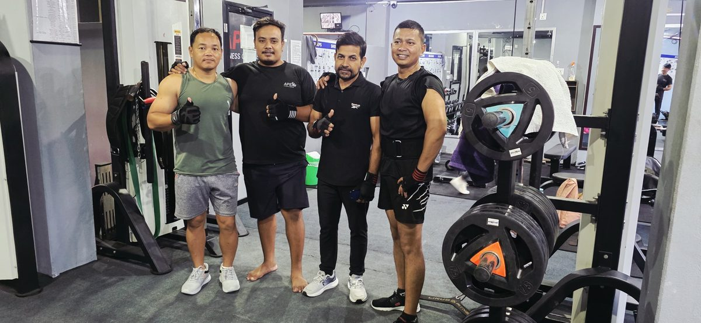
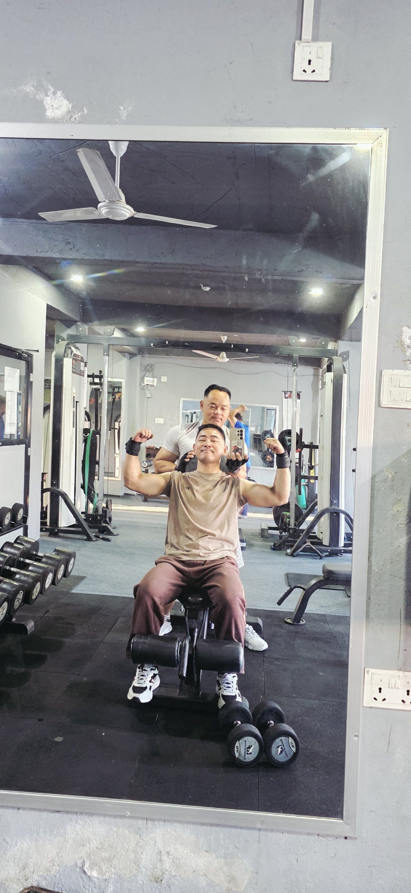

A good training partner makes it easier to show up and harder to quit halfway through a set. **In a Michigan State University study, people held a plank about 24% longer when they exercised alongside a partner who was a little better than them** ([ScienceDaily](https://www.sciencedaily.com/releases/2011/05/110518161707.htm)). Add someone waiting for you at 6 AM, and you have one of the simplest ways to stay consistent.

*Members training together at Apex Fitness Centre, Urlabari.*

## What the research says

The study, led by Professor Deborah Feltz and published in the Journal of Sport and Exercise Psychology, tested about 200 people doing planks while playing an exercise video game. Those paired with a partner whose performance was always a bit better held the exercise about 24% longer than those exercising alone. Researchers call this the Köhler effect: when we are the weaker member of a team, we push harder so we do not let the team down.

The partner in that study was virtual. A real friend at the gym adds something a screen cannot: someone who notices when you do not turn up.

## 6 benefits of a training partner

1. You show up. It is harder to skip a session when a friend is waiting.
2. You work harder. A partner who is slightly stronger pulls your effort up.
3. You lift more safely. A spotter on bench press and squats means you can attempt the last hard rep.
4. Better technique. A second pair of eyes catches a rounded back or half reps.
5. Less boredom. Rest periods pass quickly, and training becomes social time.
6. Shared goals. Training for the same trek, event or weight loss target keeps you both on track.

*A member and trainer at Apex Fitness Centre. A coach or partner keeps you accountable.*

## How to choose a good partner

- Similar schedule: if you train at 6 AM and they train at 7 PM, it will not last.
- Similar goals: strength, fat loss or a trek; it does not need to be the same, but it should fit together.
- A little ahead of you: the research suggests a partner slightly better than you motivates most. A big gap can be discouraging.
- Reliable: someone who turns up on time and does not cancel often.
- Positive: encouraging, not someone who distracts you with chat or phone videos.

## How to train together

| Situation | How to do it |
|---|---|
| Different strength levels | Use the same exercises, different weights; take turns on the bench or rack |
| Different goals | Share a warm-up and the big lifts, then do your own extra exercises |
| Spotting | Agree before the set: how many reps, and when to help |
| Rest times | Use the partner's set as your rest; you finish faster |
| Progress | Write both of your weights in one notebook or app |

New to the gym? Start with our [beginner gym workout plan](../beginner-gym-workout-plan-first-3-months/), which works well for two people sharing equipment.

## Spotting basics

- Bench press: stand behind the bench, hands near the bar, ready to help on the way up. Let the lifter do the work unless the bar stops.
- Squats: in a power rack, set the safety bars. If spotting, stand behind with your arms under the lifter's arms.
- Dumbbells: spot at the wrists or elbows, not the dumbbells.

See [how to bench press safely](../how-to-bench-press-safely/) for setup and safety.

## No partner? Other ways to stay accountable

- Join a class or a small group at your gym.
- Ask a trainer to check in on you each week.
- Share your training log with a friend, even if they train somewhere else.
- Book your sessions like appointments and set a reminder.

If you feel nervous training around others, read [gym anxiety: how to feel confident at the gym](../gym-anxiety/).

## Frequently asked questions

### Is it better to work out alone or with a partner?
Both work. A partner can help you stay consistent and push harder, especially if they are a little stronger than you. Some people prefer the focus of training alone.

### What is the Köhler effect in exercise?
The tendency to work harder when we are the weaker member of a team. In one study, people held a plank about 24% longer with a slightly better partner.

### How do I find a gym partner?
Ask friends or colleagues with a similar schedule, talk to regulars at your gym, or ask a trainer to introduce you to someone with similar goals.

### Can partners with different strength levels train together?
Yes. Do the same exercises with different weights and take turns.

### Do I need a spotter for bench press?
For heavy sets, a spotter or a rack with safety bars is strongly recommended.

## Sources

- [Virtual workout partners spur better results](https://www.sciencedaily.com/releases/2011/05/110518161707.htm) (ScienceDaily, reporting Michigan State University research, 2011)
- [WHO fact sheet: physical activity](https://www.who.int/news-room/fact-sheets/detail/physical-activity) (World Health Organization)

*General information, not medical advice. If you have a medical condition, ask your doctor before starting a new exercise programme.*
