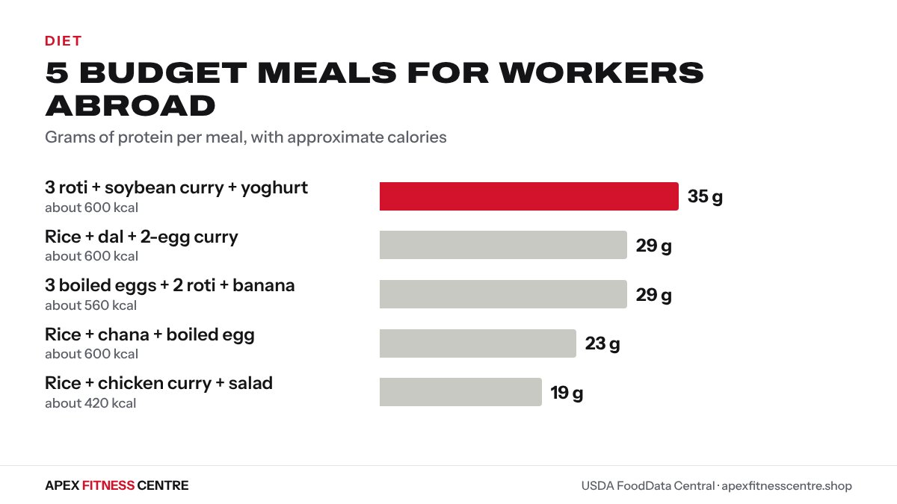

Long shifts, shared kitchens and hot weather make healthy eating hard for Nepali workers abroad. **The fix is simple: cook once or twice a week, build every meal around a cheap protein (eggs, dal, chicken or soybeans), and keep water with you all day.** You can eat food that tastes like home and still have the energy for work and training.

Nutrition numbers come from USDA FoodData Central, as shown on our [food calorie chart](../../food/).

## The budget shopping list

These are usually easy to find in Malaysian, Gulf and Indian or Nepali grocery shops:

| Food | Why buy it | Protein |
|---|---|---|
| Eggs | Cheapest quick protein, no fridge space problems for a few days | about 6.2 g per egg |
| Masoor, mung or chana dal | Cheap, keeps for months dry | about 12.6 g per katori cooked |
| Chicken (whole, legs or breast) | Cook a batch for 2 to 3 days | about 31 g per 100 g cooked breast |
| Soybean chunks | Very cheap protein, lasts dry | about 16 g per half cup cooked soybeans |
| Rice and atta | Energy for hard physical work | 4.3 g per cup cooked rice |
| Onion, tomato, garlic, ginger, frozen vegetables | Flavour and vitamins | small |
| Plain yoghurt (laban, dahi) | Cooling and helps digestion | about 5 g per katori |

## Cooking in a shared kitchen

- Cook in one big pot: dal and a protein curry, then share the work with roommates.
- Agree a rota: each person cooks once or twice a week for everyone.
- Label your boxes in the fridge with your name and date.
- Keep it simple: one dal, one curry, rice. Variety comes from changing the curry each week.
- Eat cooked food within about 3 days and freeze the rest if you have space.

## 5 meals

| Meal | Calories (approx.) | Protein (approx.) |
|---|---|---|
| Rice (1 cup) + dal (1 katori) + egg curry (2 eggs) | about 600 kcal | about 29 g |
| Rice (1 cup) + chicken curry (1 cup) + salad | about 420 kcal | about 19 g |
| 3 roti + soybean chunk curry (half cup) + yoghurt | about 600 kcal | about 35 g |
| Rice (1 cup) + chana (1 katori) + boiled egg | about 600 kcal | about 23 g |
| 3 boiled eggs + 2 roti + banana | about 560 kcal | about 29 g |

*5 budget meals for workers abroad. Source: USDA FoodData Central.*

*Approximate, from our food pages. Oil and portions change the numbers.*

## Eating for hard physical work

Construction, cleaning, warehouse and security jobs burn a lot of energy, especially in heat. Do not try to eat very little:

- Eat a proper breakfast before a long shift: eggs with roti or rice.
- Take a lunch box rather than relying on fried snacks and sweet drinks.
- Carry water and drink often. In the Gulf summer, sweating is heavy all day. Use our [water intake calculator](../../calculators/water-intake-calculator/) as a starting point, and drink more in the heat.
- Add salt to food normally if you sweat heavily, unless your doctor has told you to limit it.

Read [exercising in hot weather](../exercising-in-hot-weather/) for heat safety.

## Training after work

A short workout three times a week makes a real difference, even after a long shift. Our [workout plan for workers in Dubai, Qatar and Saudi Arabia](../gulf-workers-workout-after-long-shift/) is built for exactly this, and our [home workout without equipment](../home-workout-without-equipment/) works in a small room.

## Sending money home vs eating well

Many workers cut their food budget to send more money home. That is understandable, but eating too little protein and energy makes heavy work harder and increases the risk of getting sick. Eggs, dal and soybean chunks are some of the cheapest protein foods available, so eating well does not have to cost much.

## Frequently asked questions

### What is the cheapest protein for workers in the Gulf?
Eggs, dried lentils and soybean chunks are usually among the cheapest. Compare prices per gram of protein in your local shop.

### How can I eat healthy in a shared labour camp kitchen?
Cook in large batches with roommates, keep it simple (dal, a curry and rice), label your boxes, and eat cooked food within about 3 days.

### How much water should I drink working in the heat?
More than usual. Start with the [water intake calculator](../../calculators/water-intake-calculator/) and drink regularly through the shift, not only when thirsty.

### Can I build muscle while doing physical work?
Yes, if you eat enough protein and energy and train 2 to 3 times a week with progressive exercises.

### Is fast food okay sometimes?
Yes, sometimes. Just do not make fried snacks and sweet drinks your daily meals.

## Sources

- Food values from [USDA FoodData Central](https://fdc.nal.usda.gov/), as shown on our [food calorie chart](../../food/)
- [WHO fact sheet: healthy diet](https://www.who.int/news-room/fact-sheets/detail/healthy-diet) (World Health Organization)

*General information, not medical advice. If you feel dizzy, confused or stop sweating while working in the heat, stop, cool down and get medical help.*
