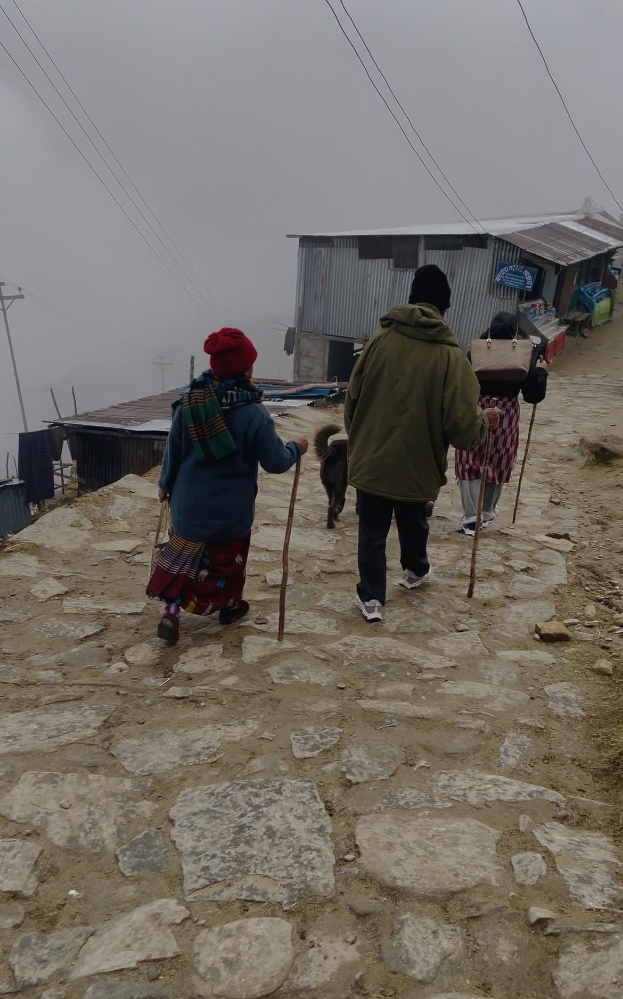
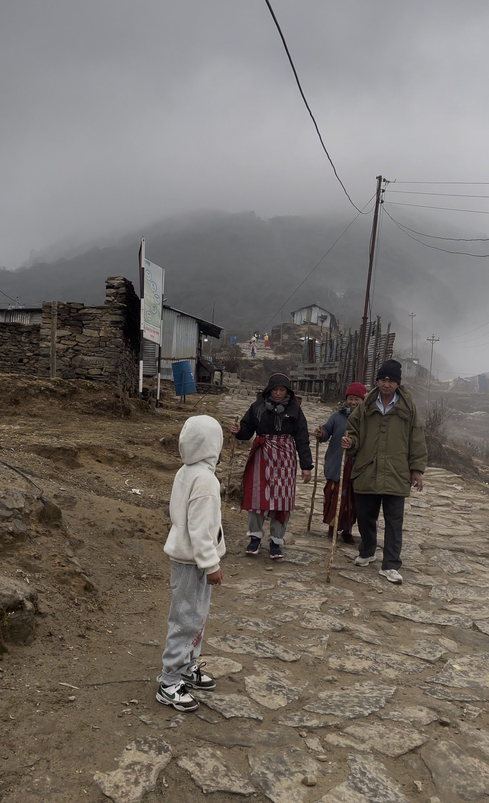

Trekking poles are one of the cheapest ways to make a Nepal trek easier on your legs. **Used well, two poles take part of the load off your knees on descents and can make climbs feel easier.** The trick is setting the right length and changing it for uphill and downhill.

*Walking down the stone trail to Pathibhara, Taplejung. Even a simple wooden stick takes some load off the knees.*

## What research says

The New York-New Jersey Trail Conference summarises three studies ([NY-NJ Trail Conference](https://www.nynjtc.org/node/3489)):

| Study | Finding |
|---|---|
| Journal of Sports Sciences, 1999 | On a steep 25-degree downhill, two poles reduced a key knee force by up to about 20% |
| Medicine & Science in Sports and Exercise, 2000 | Walking uphill with a pack, pole users had less leg muscle activity and felt the effort was lower, without using more energy |
| International Journal of Sports Medicine, 2000 | Walking uphill with about 15 kg, effort felt lower with poles, and energy use did not rise significantly |

In short: poles help your knees going down and make climbs feel easier, at little extra cost.

## Setting the right length

On flat ground: stand tall, hold the grip with your arm at your side, and adjust so your elbow is bent at about 90 degrees.

| Terrain | Adjustment |
|---|---|
| Flat | Elbow at about 90 degrees |
| Long uphill | Shorten by about 5 to 10 cm |
| Long downhill | Lengthen by about 5 to 10 cm |
| Traversing a slope | Shorter on the uphill side, longer on the downhill side |

Most poles have two or three sections with clip locks. Lock them firmly: a pole collapsing on a descent is dangerous.

## Using the straps

Put your hand up through the strap from underneath, then grip the pole with the strap across the back of your hand. This lets you push down through the strap without squeezing the grip hard all day. On very steep, rocky or icy sections where you might fall, take your hands out of the straps so a stuck pole does not twist your wrist.

## Technique

Flat and gentle trails: walk normally, moving the opposite pole to your leading foot, like your arms swing when you walk.

Uphill: shorten the poles, plant them beside or slightly behind your feet, and push. Your arms help drive you up.

Downhill: lengthen the poles, plant them slightly ahead, and lean on them a little with each step. Take short steps with your knees slightly bent. This is where poles help your knees most. More tips in [7 ways to stop knee pain when hiking downhill](../knee-pain-hiking-downhill/).

Stone steps (common in Nepal): plant both poles on the step below before you step down, especially on high steps. Going up, plant them on the next step and push.

*Stone paths like this one on the way to Pathibhara are where poles or sticks help most.*

## Common mistakes

- Poles too long uphill, which pushes your shoulders up and wastes energy.
- Not lengthening for descents, so you lean forward and lose the knee benefit.
- Gripping too hard all day, which tires your hands and forearms.
- Only one pole: two poles give balanced support.
- No rubber tips in villages and on stone: use them to protect surfaces and stop slipping.

## Which poles to choose

- Aluminium: strong, cheap, bend rather than snap. Good for most trekkers.
- Carbon: lighter but can snap if stressed sideways.
- Lock type: clip (flick) locks are easier to adjust with cold hands than twist locks.

You can buy or rent poles in Kathmandu and Pokhara before your trek. Practise with them at home: our [stair climbing workout](../stair-climbing-workout/) and [4-week trek plan](../trek-training-in-4-weeks/) are perfect for it.

## Frequently asked questions

### Do trekking poles really help your knees?
Yes. A 1999 study found two poles reduced a key knee force by up to about 20% on a steep downhill.

### How long should trekking poles be?
Elbow at about 90 degrees on flat ground; shorter going uphill and longer going downhill.

### Should I use one or two trekking poles?
Two. They give balanced support and the most benefit for your knees.

### Do I need trekking poles for Everest Base Camp?
Not required, but most trekkers find them very helpful, especially on the long descents.

### Can I take trekking poles on a plane?
Rules differ by airline and country; many require them in checked baggage. Check with your airline before you fly.

## Sources

- [Trekking poles and your knees](https://www.nynjtc.org/node/3489) (New York-New Jersey Trail Conference, summarising studies from 1999 and 2000)

*General information, not medical advice. If you have a knee, hip or shoulder problem, ask a physiotherapist how to use poles safely.*
