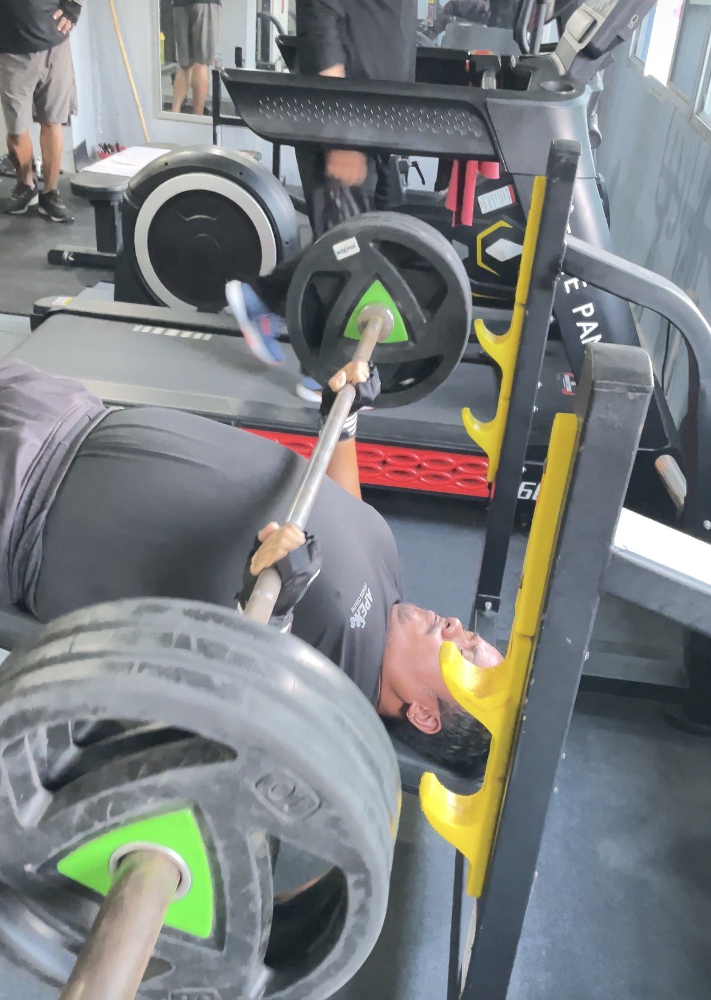
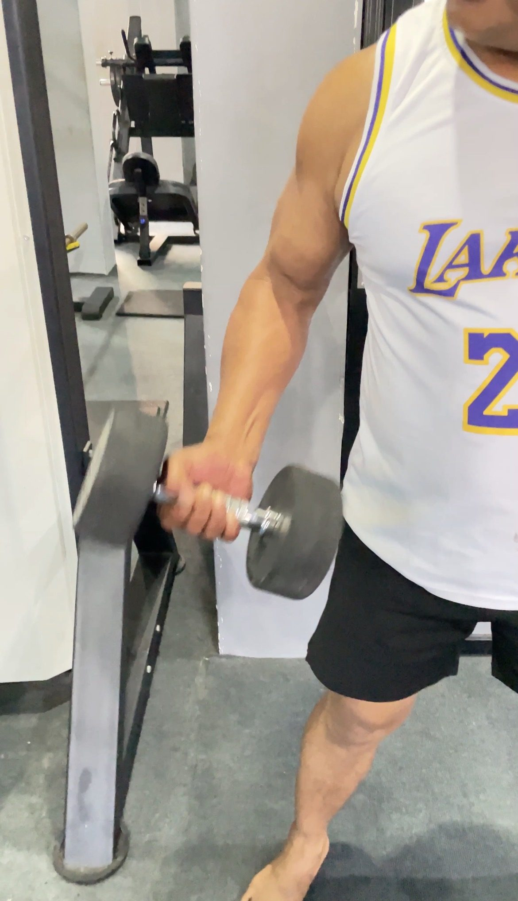
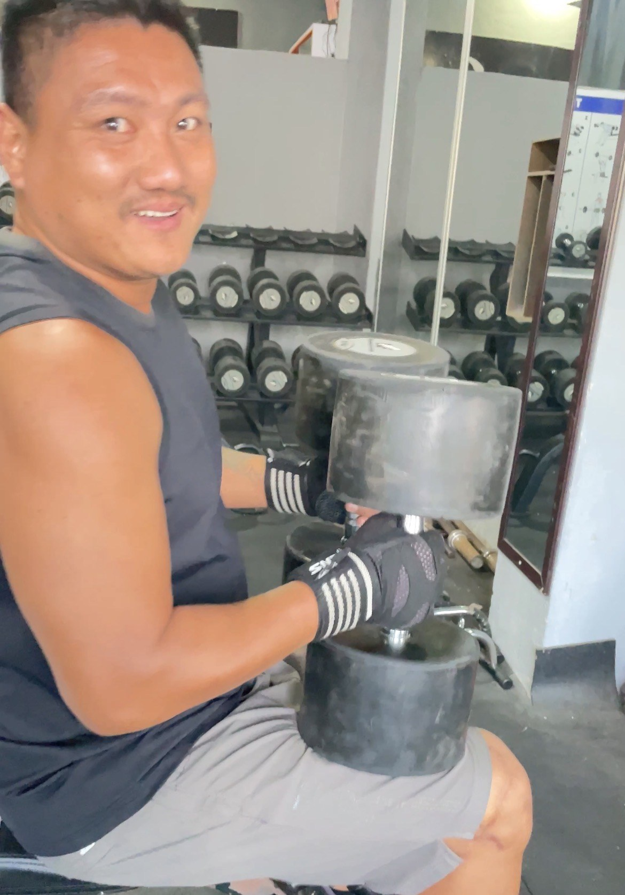
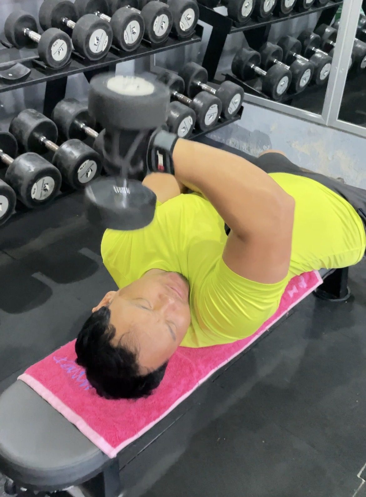

Gloves are a personal choice, not a must. **They protect your hands from calluses and help on sweaty or rough bars, but on heavy pulling exercises they can make the bar feel thicker and your grip weaker.** Many lifters use gloves for presses and machines, and bare hands or chalk for deadlifts and pull-ups.

*A member pressing with gloves at Apex Fitness Centre. Gloves are common on presses.*

## What gloves are good for

- Fewer calluses and blisters, especially if your hands are sensitive or your job needs soft hands.
- Grip on sweaty hands, which helps in hot, humid weather.
- Comfort on rough or worn bars, dumbbell handles and machine grips.
- Hygiene: some people simply prefer not to touch shared equipment.
- Confidence: if gloves make you more comfortable training, that is a good reason.

## Where gloves can hold you back

- Thicker grip: the padding makes the bar feel thicker, which can make heavy deadlifts, rows and pull-ups harder to hold.
- Less feel: you feel the bar less, which can affect control.
- Bunching: cheap gloves fold and pinch in the palm on pulling exercises.
- Hand toughness: your hands adapt less if they never touch the bar.

*Bare hands on a dumbbell curl. Many lifters keep gloves for presses only.*

## Gloves, wraps, straps or chalk?

| Tool | What it does | Best for |
|---|---|---|
| Lifting gloves | Protect palms, add grip on sweaty hands | Presses, machines, dumbbells, cable work |
| Wrist wraps | Support the wrist joint | Heavy bench press and overhead press |
| Lifting straps | Lock your hands to the bar | Heavy rows and deadlifts when grip gives out first |
| Chalk | Dries sweat, improves grip | Deadlifts, pull-ups, any heavy pull (if your gym allows it) |
| Bare hands | Best feel and grip strength | Everything, if your hands are comfortable |

Many gloves also come with a built-in wrist wrap, which is popular for pressing.

*Gloves with built-in wrist support, popular for heavy dumbbell work.*

## A simple rule

- Pressing, machines, dumbbells, cables: gloves are fine if you like them.
- Heavy deadlifts, rows, pull-ups: try bare hands or chalk first; use straps for your heaviest sets if grip is the limit.
- Beginners: train your grip too. Holding heavy dumbbells for 20 to 30 seconds (farmer's holds) at the end of a session builds it quickly.

*Gloves on a dumbbell press, where the extra grip and padding help most.*

## Choosing gloves

- Thin padding keeps the grip closer to bare hands.
- Breathable material for hot weather.
- A snug fit so they do not bunch in the palm.
- Optional wrist strap if you press heavy.

## Build your grip without gloves

A stronger grip helps on almost every lift, and it is easy to train:

| Exercise | How | Sets |
|---|---|---|
| Farmer's walk | Hold heavy dumbbells at your sides and walk | 3 x 20 to 30 metres |
| Dead hang | Hang from a pull-up bar with straight arms | 3 x as long as you can |
| Plate pinch | Pinch two weight plates together, smooth sides out | 3 x 20 seconds |
| Slow lowering | Lower the last rep of rows or deadlifts over 3 seconds | On your normal sets |

Do one or two of these at the end of a session, two or three times a week.

## Look after your hands

Calluses are normal for lifters. To stop them tearing:

- Hold the bar low in your palm, near your fingers, on pulling exercises, so the skin does not pinch.
- File down thick calluses gently once a week.
- Moisturise your hands at night.

## Learn more

Good technique matters more than any accessory. Start with [how to bench press safely](../how-to-bench-press-safely/) and [how to deadlift for beginners](../how-to-deadlift-for-beginners/). Thinking about a belt too? Read [do you need a lifting belt?](../do-you-need-a-lifting-belt/).

## Frequently asked questions

### Should beginners wear lifting gloves?
It is up to you. Gloves are fine for most exercises, but train some lifts with bare hands so your grip gets stronger.

### Do lifting gloves reduce grip strength?
They can make the bar feel thicker, which may make heavy pulling exercises harder to hold. On presses and machines it matters less.

### Are gloves or chalk better for deadlifts?
Most lifters find chalk or bare hands give a stronger, more secure grip on heavy deadlifts than gloves.

### Do gloves prevent calluses?
They reduce them. Holding the bar correctly and caring for your skin also helps.

### What is the difference between gloves and wrist wraps?
Gloves protect your palms; wrist wraps support your wrist joint on heavy presses. Some gloves include a wrist wrap.

## Sources

- [Strength exercises](https://www.nhs.uk/live-well/exercise/strength-exercises/) (NHS)

*General information, not medical advice. If you have wrist or hand pain, ask a physiotherapist before heavy lifting.*
