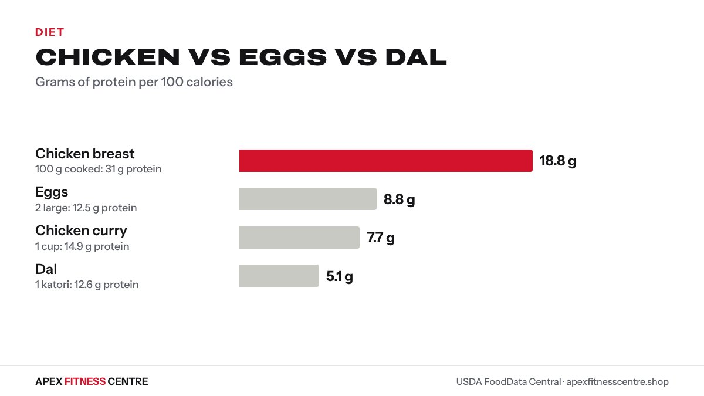

All three are good protein foods, but they do different jobs. **Chicken breast gives the most protein for its calories, eggs are the easiest and quickest, and dal gives protein plus fibre and energy.** For most people in Nepal, the best plan is to eat all three across the week.

All numbers are USDA values, as shown on our [food calorie chart](../../food/).

## The numbers

| Serving | Protein | Calories | Protein per 100 kcal |
|---|---|---|---|
| [Chicken breast](../../food/chicken-breast-calories/), 100 g cooked | 31.0 g | 165 kcal | 18.8 g |
| [Eggs](../../food/egg-calories/), 2 large (100 g) | 12.5 g | 142 kcal | 8.8 g |
| [Dal](../../food/dal-calories/), 1 katori (150 g) | 12.6 g | 248 kcal | 5.1 g |
| [Chicken curry](../../food/chicken-curry-calories/), 1 cup with gravy | 14.9 g | 194 kcal | 7.7 g |

*Chicken vs eggs vs dal. Source: USDA FoodData Central.*

Note the difference between plain chicken breast and chicken curry: the gravy, oil and bone change the numbers a lot.

## Chicken: the most protein per calorie

Best for: losing fat while keeping muscle, and anyone who needs a lot of protein.

- 100 g of cooked breast gives about 31 g of protein.
- Very little fat if you remove the skin and cook with little oil.
- Takes time to cook; cook a batch for 2 to 3 days.

## Eggs: the easiest

Best for: breakfasts, snacks, busy days, students and workers.

- Two large eggs give about 12.5 g of protein in minutes.
- Easy to carry boiled.
- Many healthy people can eat several eggs a day; see [how many eggs can you eat a day](../how-many-eggs-per-day/).

## Dal: protein plus fibre and energy

Best for: everyday meals, vegetarians, and anyone who needs energy for work or training.

- A katori gives about 12.6 g of protein plus about 11 g of fibre.
- It also brings carbohydrate and the oil it is cooked with, so it has more calories per gram of protein.
- Cooking it thicker and eating a full katori makes a real difference. See [how much protein is in dal bhat](../dal-bhat-protein/).

## Cost: protein for your money

Prices change by town and season, so do this quick check where you shop. Divide the price by the grams of protein you get:

| Food | Protein in the amount you buy |
|---|---|
| 1 tray of 30 eggs | about 187 g (6.2 g per egg) |
| 1 kg dry masoor dal | about 250 g (dry lentils are roughly a quarter protein) |
| 1 kg raw chicken breast | about 225 to 230 g (it shrinks when cooked) |

Dry dal is usually the cheapest protein per gram, eggs come next, and chicken breast costs the most. That is why a mix of all three works well on a budget.

## How to cook each for more protein

- Dal: cook it thick, not watery, and eat a full katori. Mixing mung, masoor and chana dal adds variety.
- Eggs: boil a batch for two days. Add an extra egg to your omelette instead of more oil.
- Chicken: remove the skin, use breast or boneless thigh, and cook with less oil. A pressure cooker keeps it soft.
- Combine them: egg curry with dal, or chicken with a katori of dal, gives a big protein meal from ordinary food.

## Which should you choose?

| Your goal | Lean on | Why |
|---|---|---|
| Losing weight | Chicken breast, eggs | Most protein for the calories |
| Building muscle | All three | Protein plus enough energy to grow |
| Vegetarian | Dal, eggs (if you eat them) | Add soybeans and tofu too |
| Tight budget | Eggs and dal | Cheap and easy |
| Very busy | Eggs | Ready in minutes |

## A day using all three

| Meal | Food | Protein (approx.) |
|---|---|---|
| Breakfast | 2 boiled eggs | 12.5 g |
| Khana | Rice (1 plate, about 300 g), 1 katori dal, saag | about 23 g |
| Snack | 1 katori curd | 5.2 g |
| Dinner | 2 roti, 150 g chicken breast curry, vegetables | about 55 g |

That is roughly 95 to 100 g of protein, enough for a 60 to 70 kg person who trains. Check your own target with the [protein calculator](../../calculators/protein-calculator/), and see [tofu vs soybeans vs chana](../tofu-vs-soybeans-vs-chana-protein/) for vegetarian options.

## Frequently asked questions

### Which has more protein, eggs or chicken?
Chicken breast: about 31 g per 100 g cooked, compared with about 12.5 g in two large eggs (100 g).

### Is dal a good protein source?
Yes. A katori of dal gives about 12.6 g of protein plus fibre. It has more calories per gram of protein than chicken, so portion size matters when losing weight.

### Is it okay to eat eggs every day?
For most healthy people, yes. If you have high cholesterol or diabetes, ask your doctor how many suit you.

### What is the cheapest protein in Nepal?
Usually eggs, dal and soybeans. Prices change, so compare the cost per gram of protein where you shop.

### Can I build muscle on dal and eggs only?
Yes, if you eat enough of them to reach your daily protein target and train with progressive weights.

## Sources

- Food values from [USDA FoodData Central](https://fdc.nal.usda.gov/), as shown on our [food calorie chart](../../food/)
- [ISSN position stand: protein and exercise](https://pubmed.ncbi.nlm.nih.gov/28642676/) (Jäger et al., 2017)

*General information, not medical advice. If you have kidney disease, high cholesterol or another condition, ask your doctor which protein foods suit you.*
